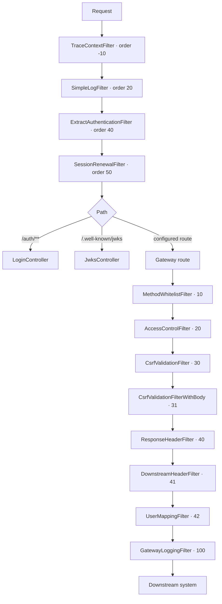

# Migrate from WebFlux to virtual threads (Spring Cloud Gateway Server MVC) — Implementation Plan

> **For agentic workers:** REQUIRED SUB-SKILL: Use superpowers:subagent-driven-development (recommended) or superpowers:executing-plans to implement this plan task-by-task. Steps use checkbox (`- [ ]`) syntax for tracking.

**Goal:** Replace OAG's reactive runtime (`spring-cloud-starter-gateway-server-webflux`, Netty, Reactor) with the blocking servlet runtime (`spring-cloud-starter-gateway-server-webmvc`, Tomcat) running on virtual threads, so that all OAG code is plain sequential Java with no `Mono`/`Flux`/`Scheduler` anywhere, while every externally observable behaviour stays identical.

**Architecture:** Three phases. **Phase A** removes Reactor from the OAG logic while the WebFlux runtime is still active — every task keeps `./gradlew build` green, so the 108-test suite continuously proves behaviour is unchanged. **Phase B** is the single atomic runtime swap: WebFlux types (`ServerWebExchange`, `WebFilter`, `GlobalFilter`) become servlet types (`HttpServletRequest`, `jakarta.servlet.Filter`, `HandlerFilterFunction`), routing moves from `RouteLocator` to `RouterFunction<ServerResponse>`, and `spring.threads.virtual.enabled=true` puts every request on a virtual thread. A web framework cannot be half-swapped, so this is one task, verified by the unchanged integration suite acting as the equivalence oracle. **Phase C** removes the now-dead reactive scaffolding, converts the test client, and updates docs and packaging.

**Tech Stack:** Spring Cloud Gateway Server MVC 5.0.2 (`spring-cloud-gateway-server-webmvc`) · Spring Cloud 2025.1.2 · Spring Boot 4.1.0 · Spring Framework 7.0.8 · Tomcat (Boot default) · JDK HttpClient for downstream calls · Java 25 virtual threads · Gradle 9

## Global Constraints

- **Target starter is `org.springframework.cloud:spring-cloud-starter-gateway-server-webmvc`**, version managed by the existing `spring-cloud-dependencies:2025.1.2` BOM (resolves to 5.0.2). Do not add an explicit version.
- **Do not change Spring Boot, Spring Cloud, Gradle or Java versions.** Boot stays `4.1.0`, Spring Cloud `2025.1.2`, Java toolchain `25`. This iteration changes only the web runtime.
- **Servlet container: Tomcat** (Boot default, comes with `spring-boot-starter-web` via the mvc starter). Do not switch to Jetty or Undertow.
- **Downstream HTTP client: JDK `HttpClient`.** With reactor-netty and Apache HttpClient5 absent from the runtime classpath, Boot's `ClientHttpRequestFactory` detection selects `JdkClientHttpRequestFactory`. Do not add `httpclient5`.
- **Virtual threads are enabled via `spring.threads.virtual.enabled=true`** in `oag/src/main/resources/application.yaml`. Nothing else is needed — Tomcat's request executor and `@Async`/scheduling switch to virtual threads from that one property.
- **Public API breaks and the version is bumped.** `UserMapper`, `SessionHook`, `SessionBlacklist`, `CsrfProtectionValidation` and `LoginDriver` change signatures. Bump `version` in `oag/build.gradle` from `0.7.2-SNAPSHOT` to `0.8.0-SNAPSHOT` (Task 10).
- **The 108-test suite is the equivalence oracle and must not be weakened.** Never `@Disabled` a test, never use `-PskipTests`, never relax an assertion to make a task pass. Integration tests keep driving the gateway through `WebTestClient` until Task 9; do not touch test *assertions* before then — only the plumbing a signature change forces.
- **Every task ends with `./gradlew build --console=plain` printing `BUILD SUCCESSFUL`** with all tests passing, run from `oag/`.
- **Phase A commits are intentionally not releasable.** Making `SessionBlacklist` and the JWT signer blocking while Netty is still the runtime means those calls briefly block an event-loop thread. That is accepted and temporary: the branch is only merged after Task 10. Do not add `Schedulers.boundedElastic()` back to "fix" it.
- **No behaviour changes, except the four listed below.** Response status codes, headers, cookies (names, `SameSite`, `Secure`, `HttpOnly`, `Max-Age`, `Path`), redirect targets, downstream headers and log messages stay as they are. If a step tempts you to "improve" behaviour beyond this list, don't — note it and move on. The four accepted changes, each mandated by a specific step:
  1. **Task 1** — logout session-blacklisting becomes synchronous. It was fire-and-forget (`ReactiveUtils.subscribeAsynchronously`), so a logout could return before the session was actually blacklisted. The new behaviour is strictly stronger.
  2. **Task 3** — `JwksController`'s two `debug` log lines start being emitted. They were wrapped in `LoggingUtils.contextual(...)` whose returned `Mono` was discarded, so they never executed.
  3. **Task 4** — `DownstreamHeaderFilter`'s trace line says `"Execute DownstreamHeaderFilter"` instead of the copy-pasted `"Execute ResponseHeaderFilter"`.
  4. **Task 5** — the route name is set in a filter instead of in the route predicate. This is a prerequisite for Task 7, not a cleanup: `RequestPredicates` in Spring MVC's functional router snapshots and restores the request attribute map while evaluating nested predicates, so an attribute written from inside a predicate cannot be relied on afterwards.
- **The 4xx `errorReason` log detail must be preserved.** `SimpleLogFilter` currently logs the `ResponseStatusException` reason for failed requests (`"Response status code {} for {} {} errorReason: '{}'"`). Task 7 must keep emitting that detail after the port to a servlet filter. Losing it is a regression, not an acceptable simplification.
- **Config rule:** one `spring:` top-level block per YAML file. `application.yaml` already has one; add new Spring keys inside it, never as a second `spring:` key.
- **Language:** English in code, config, commit messages and docs. Documentation describes the *current* state — no "was WebFlux before" history in the docs themselves.
- **Javadoc is enforced.** `check` depends on the `requireJavadoc` task; every public/protected/package-private class, method and field needs Javadoc or the build fails.
- **Commit after every task.** Small commits, no squashing tasks together.

**Working directory:** all `./gradlew` commands run from `oag/`. Paths below are relative to the repository root.

**Verified reference facts** (checked directly against `spring-cloud-gateway-server-webmvc-5.0.2.jar` and `spring-webmvc-7.0.8` sources — do not re-derive):

- There is **no `GlobalFilter` equivalent** in server-mvc. Cross-cutting behaviour is either a `jakarta.servlet.Filter` bean (runs before routing) or a `HandlerFilterFunction` attached per route.
- `RouterFunctions.Builder` applies filters in **registration order**: the first `.before(...)`/`.filter(...)` registered runs first (`build()` reduces with `HandlerFilterFunction::andThen`, and `f1.andThen(f2)` runs `f1` first).
- `ProxyExchangeHandlerFunction` (returned by `HandlerFunctions.http()`) builds the downstream URL as **scheme/host/port from `MvcUtils.GATEWAY_REQUEST_URL_ATTR`, path and query from the current (possibly rewritten) `ServerRequest.uri()`** — identical semantics to the WebFlux `RouteToRequestUrlFilter` + `NettyRoutingFilter` pair. The route URL's path is ignored in both.
- `BeforeFilterFunctions.rewritePath(regex, replacement)` calls `MvcUtils.addOriginalRequestUrl(request, request.uri())` before rewriting, so `GATEWAY_ORIGINAL_REQUEST_URL_ATTR` is always populated for OAG routes.
- `MvcUtils.getAttribute(request, key)` reads `request.attributes()`, then the gateway attribute map, then falls back to `request.servletRequest().getAttribute(key)` — so attributes set by a servlet filter on the `HttpServletRequest` are readable from route filters.
- `MvcUtils.getOrCacheBody(request)` returns a `ByteArrayInputStream` of the full body and stores it under `CACHED_REQUEST_BODY_ATTR`; `BeforeFilterFunctions.adaptCachedBody()` makes the proxy re-read that cached body. This pair replaces `ModifyRequestBodyGatewayFilterFactory`.
- `org.springframework.http.ResponseCookie` and `org.springframework.http.HttpCookie` are framework-neutral (`spring-web`, not `spring-webflux`). **`CookieConverter` needs no change at all** — in servlet code, write cookies with `response.addHeader(HttpHeaders.SET_COOKIE, responseCookie.toString())`.
- `spring-boot-starter-webflux-test` (test scope) keeps `WebTestClient` and reactor-netty available. Boot still selects `WebApplicationType.SERVLET` because `DispatcherServlet` is on the classpath — REACTIVE is only chosen when webmvc is *absent*.
- **Server-mvc does not proxy WebSockets** (the WebFlux gateway does). OAG configures no WebSocket routes and has no WebSocket tests, so nothing breaks, but it is a real capability change to document (Task 10).

---

## File Structure

Files created, modified or deleted across the whole plan, and what each is responsible for afterwards.

**Deleted**

| File | Why |
| ---- | --- |
| `oag/src/main/java/org/owasp/oag/utils/ReactiveUtils.java` | Only existed to push blocking work onto `Schedulers.boundedElastic()`. Meaningless on virtual threads. |
| `oag/src/main/java/org/owasp/oag/filters/proxy/ReadRequestBodyFilter.java` | Replaced by direct `MvcUtils.getOrCacheBody` use in `CsrfValidationFilterWithBody`. |
| `oag/src/main/java/org/owasp/oag/gateway/SpringCloudGatewayConfiguration.java` | Replaced by `GatewayRouterFunctionConfiguration` (routing) and `SchedulerConfiguration` (the two schedulers). |

**Created**

| File | Responsibility |
| ---- | -------------- |
| `oag/src/main/java/org/owasp/oag/infrastructure/SchedulerConfiguration.java` | The `keyRotationScheduler` and `cleanupScheduler` beans. |
| `oag/src/main/java/org/owasp/oag/logging/TraceHeaders.java` | Framework-free value object: trace id + headers to add downstream + headers to add to the response. |
| `oag/src/main/java/org/owasp/oag/gateway/GatewayRouterFunctionConfiguration.java` | Builds one `RouterFunction<ServerResponse>` from `MainConfig.getRoutes()`, in specificity order, with OAG's route filters attached. |
| `oag/src/main/java/org/owasp/oag/cookies/CookieWriter.java` | Writes a `ResponseCookie` to an `HttpServletResponse` as a `Set-Cookie` header, preserving `SameSite`. |
| `oag/src/test/java/org/owasp/oag/gateway/GatewayRouterFunctionConfigurationTest.java` | Verifies route ordering, route-name attribute, rewrite and filter execution order. |
| `oag/src/test/java/org/owasp/oag/logging/TraceContextBridgeTest.java` | Verifies the `TraceHeaders` produced for new / valid-incoming / invalid-incoming traces. |
| `oag/src/test/java/org/owasp/oag/filters/servlet/ExtractAuthenticationFilterTest.java` | Verifies session extraction, blacklist rejection and CSRF-token exposure via request attributes. |
| `oag/src/test/java/org/owasp/oag/integration/mockserver/VirtualThreadTest.java` + `VirtualThreadProbeFilter.java` | Prove requests are handled on virtual threads. |
| `oag/src/test/java/org/owasp/oag/integration/testInfrastructure/TestClientFactory.java` | Builds a `RestTestClient` that trusts the gateway's self-signed certificate. |
| `oag/src/test/java/org/owasp/oag/integration/testInfrastructure/AbstractServerTest.java` | Annotation-free ancestor of both test base classes, holding the port and the client. |
| `www/docs/docs/Architecture-Request-Handling.md` | Documents the servlet filter / route filter pipeline and the virtual-thread model. |

**Substantially rewritten (WebFlux → servlet)**

| File | Afterwards |
| ---- | ---------- |
| `filters/spring/*` → `filters/servlet/*` (`TraceContextFilter`, `SimpleLogFilter`, `ExtractAuthenticationFilter`, `SessionRenewalFilter`) | `OncePerRequestFilter` beans, ordered, running before routing. Package renamed because `spring` said nothing; `servlet` says what they are. |
| `filters/proxy/RouteAwareFilter.java` | `HandlerFilterFunction<ServerResponse, ServerResponse>` base class building `GatewayRouteContext` from a `ServerRequest`. |
| `filters/proxy/{AccessControl,CsrfValidation,CsrfValidationWithBody,DownstreamHeader,GatewayLogging,MethodWhitelist,ResponseHeader,UserMapping}Filter.java` | Blocking `HandlerFilterFunction`s. |
| `controllers/{LoginController,JwksController}.java` | Blocking `@RestController`s taking `HttpServletRequest`/`HttpServletResponse`. |
| `hooks/session/*` | `SessionHook` takes `HttpServletResponse` / `HttpServletRequest`. |
| `services/csrf/*` | `CsrfProtectionValidation.shouldBlockRequest(HttpServletRequest, String)`. |
| `services/tokenMapping/*` | `UserMapper.mapUserToRequest(ServerRequest, GatewayRouteContext)` returning a `ServerRequest`. |
| `services/blacklist/*` | Blocking `SessionBlacklist`. |
| `services/login/drivers/*` | `LoginDriver.processCallback(HttpServletRequest, String, URI)`. |
| `utils/LoggingUtils.java` | MDC-only. No Reactor imports. |

---

### Task 1: Make `SessionBlacklist` blocking

Removes `Mono` from the session-invalidation path. `LocalPersistentBlacklist` already does all its real work in `*Blocking` methods, so this mostly deletes wrappers.

**Files:**
- Modify: `oag/src/main/java/org/owasp/oag/services/blacklist/SessionBlacklist.java`
- Modify: `oag/src/main/java/org/owasp/oag/services/blacklist/LocalPersistentBlacklist.java`
- Modify: `oag/src/main/java/org/owasp/oag/filters/spring/ExtractAuthenticationFilter.java`
- Modify: `oag/src/main/java/org/owasp/oag/hooks/session/AddSessionToBlacklistHook.java`
- Test: `oag/src/test/java/org/owasp/oag/services/blacklist/LocalPersistentBlacklistTest.java`

**Interfaces:**
- Consumes: `PersistentMap<Integer>`, `GlobalClockSource` (unchanged).
- Produces: `SessionBlacklist` with `void invalidateSession(String identifier, int ttl)`, `boolean isInvalidated(String identifier)`, `void cleanup()`. Task 7 relies on these exact signatures.

- [x] **Step 1: Confirm the green baseline**

Run: `./gradlew build --console=plain`
Expected: ends with `BUILD SUCCESSFUL`. If it does not, stop and fix the baseline first — you cannot tell a migration regression from a pre-existing failure otherwise.

- [x] **Step 2: Rewrite the test to the blocking API (it will not compile yet)**

Replace the body of `oag/src/test/java/org/owasp/oag/services/blacklist/LocalPersistentBlacklistTest.java` with:

```java
package org.owasp.oag.services.blacklist;

import org.junit.jupiter.api.Test;
import org.owasp.oag.infrastructure.GlobalClockSource;
import org.owasp.oag.persistentmap.InMemoryPersistentMap;

import java.time.Clock;
import java.time.Duration;
import java.time.Instant;
import java.time.ZoneId;

import static org.junit.jupiter.api.Assertions.assertFalse;
import static org.junit.jupiter.api.Assertions.assertTrue;

/**
 * Tests the blocking contract of the local persistent session blacklist.
 */
public class LocalPersistentBlacklistTest {

    private static final Instant START = Instant.parse("2026-01-01T00:00:00Z");

    private GlobalClockSource clockSource(Instant now) {
        var clockSource = new GlobalClockSource();
        clockSource.setGlobalClock(Clock.fixed(now, ZoneId.of("UTC")));
        return clockSource;
    }

    private LocalPersistentBlacklist blacklist(GlobalClockSource clockSource) {
        return new LocalPersistentBlacklist(clockSource, new InMemoryPersistentMap<>());
    }

    @Test
    void invalidatedSessionsAreReportedAsInvalidated() {

        var blacklist = blacklist(clockSource(START));

        blacklist.invalidateSession("1", 100);
        blacklist.invalidateSession("2", 200);

        assertTrue(blacklist.isInvalidated("1"));
        assertTrue(blacklist.isInvalidated("2"));
        assertFalse(blacklist.isInvalidated("3"));
    }

    @Test
    void repeatedLookupsReturnTheSameResult() {

        var blacklist = blacklist(clockSource(START));
        blacklist.invalidateSession("1", 100);

        assertTrue(blacklist.isInvalidated("1"));
        assertTrue(blacklist.isInvalidated("1"));
        assertFalse(blacklist.isInvalidated("3"));
    }

    @Test
    void cleanupRemovesEntriesWhoseTtlHasExpiredAndKeepsTheOthers() {

        var clockSource = clockSource(START);
        var blacklist = blacklist(clockSource);

        blacklist.invalidateSession("1", 100);
        blacklist.invalidateSession("2", 200);

        // Move past the ttl of "1" but not of "2"
        clockSource.setGlobalClock(Clock.fixed(START.plus(Duration.ofSeconds(150)), ZoneId.of("UTC")));
        blacklist.cleanup();

        assertFalse(blacklist.isInvalidated("1"));
        assertTrue(blacklist.isInvalidated("2"));
    }

    @Test
    void deleteAllEntriesClearsTheBlacklist() {

        var blacklist = blacklist(clockSource(START));
        blacklist.invalidateSession("1", 100);

        blacklist.deleteAllEntries();

        assertFalse(blacklist.isInvalidated("1"));
    }
}
```

Before running it, open `oag/src/main/java/org/owasp/oag/infrastructure/GlobalClockSource.java` and check the accessor names. If the setter is not `setGlobalClock(Clock)`, use whatever it actually is and keep the test's intent (a clock you can move forward). If the class has no setter at all, construct two `LocalPersistentBlacklist` instances instead — one per clock — sharing a single `InMemoryPersistentMap` instance passed into both constructors.

- [x] **Step 3: Run the test to verify it fails**

Run: `./gradlew test --tests 'org.owasp.oag.services.blacklist.LocalPersistentBlacklistTest' --console=plain`
Expected: FAIL at compilation — `incompatible types: Mono<Void> cannot be converted to void` / `boolean` (or `cannot find symbol: method isInvalidated(String)` reported as a type error on `assertTrue`).

- [x] **Step 4: Change the `SessionBlacklist` interface**

In `SessionBlacklist.java`, delete the `import reactor.core.publisher.Mono;` line and change the three methods to:

```java
    /**
     * Marks a session identifier as invalidated. Is usually called during logout.
     * The contract is that isInvalidated with the same string must be true for at least the ttl time in seconds.
     * Implementation might keep the identifier on the blacklist for longer.
     *
     * @param identifier The session identifier to invalidate
     * @param ttl The time to live in seconds for the invalidation
     */
    void invalidateSession(String identifier, int ttl);

    /**
     * Checks if a session identifier was invalidated. Must return true if a identifier was not longer ago than the ttl.
     *
     * @param identifier The session identifier to check
     * @return true if the identifier is invalidated, false otherwise
     */
    boolean isInvalidated(String identifier);

    /**
     * Should clean up obsolete entries in the blacklist (See expiration).
     * Can be regularly called by the runtime.
     */
    void cleanup();
```

- [x] **Step 5: Collapse `LocalPersistentBlacklist` onto the blocking methods**

In `LocalPersistentBlacklist.java`: delete the imports `org.owasp.oag.utils.ReactiveUtils`, `org.owasp.oag.utils.LoggingUtils` and `reactor.core.publisher.Mono`. Change the constructor's `cleanup().block();` to `cleanup();` and `deleteAllEntries()`'s `cleanup().block();` to `cleanup();`. Then replace the three public reactive methods with:

```java
    /**
     * Invalidates a session identifier by adding it to the blacklist and the bloom filter.
     *
     * @param identifier The session identifier to invalidate
     * @param ttl The time to live in seconds for the invalidation
     */
    @Override
    public void invalidateSession(String identifier, int ttl) {

        log.trace("Invalidate identifier {}", identifier);

        int currentTimeSeconds = clockSource.getEpochSeconds();
        blacklist.put(identifier, currentTimeSeconds + ttl);
        bloomFilter.put(identifier);

        log.trace("Stored identifier {} in blacklist db", identifier);
    }

    /**
     * Checks if a session identifier is invalidated (blacklisted).
     * Uses a bloom filter to answer negative lookups without touching the map.
     *
     * @param identifier The session identifier to check
     * @return true if the identifier is invalidated, false otherwise
     */
    @Override
    public boolean isInvalidated(String identifier) {

        if (!bloomFilter.mightContain(identifier)) {
            log.trace("Identifier {} is not in bloom filter", identifier);
            return false;
        }

        var isInDb = blacklist.get(identifier) != null;
        log.trace("Lookup for identifier {} returned {}", identifier, isInDb);
        return isInDb;
    }

    /**
     * Removes expired entries from the blacklist and rebuilds the bloom filter.
     */
    @Override
    public void cleanup() {
        cleanupBlocking();
    }
```

Then delete the now-unreachable private helpers `invalidateSessionBlocking` and `checkIfInDbBlocking`. Keep `cleanupBlocking()` (it is public and `cleanup()` delegates to it) and keep `deleteAllEntries()`.

- [x] **Step 6: Run the test to verify it passes**

Run: `./gradlew test --tests 'org.owasp.oag.services.blacklist.LocalPersistentBlacklistTest' --console=plain`
Expected: `BUILD SUCCESSFUL`, 4 tests passing. Compilation of the rest of `main` will still fail if you run the full build — that is fixed in the next step.

- [x] **Step 7: Fix the two callers**

In `ExtractAuthenticationFilter.java`, replace `extractAndStoreAuthentication` with a synchronous version and simplify `filter`:

```java
    @NonNull
    @Override
    public Mono<Void> filter(@NonNull ServerWebExchange exchange, WebFilterChain chain) {

        LoggingUtils.logTrace(log, exchange, "Execute ExtractAuthenticationFilter");

        extractAndStoreAuthentication(exchange);
        return chain.filter(exchange);
    }

    /**
     * Extracts authentication from the login cookie and stores it in the exchange attributes.
     * Also checks if the session has been invalidated.
     *
     * @param exchange The server web exchange
     */
    protected void extractAndStoreAuthentication(ServerWebExchange exchange) {

        exchange.getAttributes().put(OAG_SESSION, Optional.empty());

        var loginCookieOptional = extractLoginCookieFromRequest(exchange);
        if (loginCookieOptional.isEmpty())
            return;

        var loginCookie = loginCookieOptional.get();

        if (sessionBlacklist.isInvalidated(loginCookie.getId())) {
            LoggingUtils.logInfo(log, exchange, "Received invalidated session cookie with id: {} user-id: {}",
                    loginCookie.getId(), loginCookie.getUserModel().getId());
            return;
        }

        var sessionOptional = Session.fromSessionCookie(loginCookie, globalClockSource.getGlobalClock());

        if (sessionOptional.isEmpty()) {
            LoggingUtils.logDebug(log, exchange, "Received invalid session cookie, maybe expired");
        }

        // Extract csrf token from session cookie and store in context
        exchange.getAttributes().put(OAG_SESSION_CSRF_TOKEN, loginCookie.getCsrfToken());
        // Store session optional in http request object
        exchange.getAttributes().put(OAG_SESSION, sessionOptional);
    }
```

In `AddSessionToBlacklistHook.java`, delete the `org.owasp.oag.utils.ReactiveUtils` import and replace `destroySession` with:

```java
    /**
     * Destroys a session by adding it to the blacklist.
     *
     * @param filterContext The filter context.
     * @param exchange      The server web exchange.
     */
    @Override
    public void destroySession(Map<String, Object> filterContext, ServerWebExchange exchange) {

        Optional<Session> sessionOptional = ExtractAuthenticationFilter.extractSessionFromExchange(exchange);

        sessionOptional.ifPresent(session -> {
            sessionBlacklist.invalidateSession(session.getId(), session.getRemainingTimeSeconds());
            logDebug(log, exchange, "Session {} invalidated", session.getId());
        });
    }
```

Note the deliberate behaviour change: invalidation was previously fire-and-forget (`subscribeAsynchronously`), so a logout could return before the session was actually blacklisted. It is now synchronous, which is strictly stronger and is what `CsrfLogoutTest` and `LoginLogoutTest` expect anyway.

- [x] **Step 8: Run the full build**

Run: `./gradlew build --console=plain`
Expected: `BUILD SUCCESSFUL`, all tests pass. `LoginLogoutTest` and `CsrfLogoutTest` in particular must still pass — they cover logout-then-reuse-cookie.

- [x] **Step 9: Commit**

```bash
git add oag/src/main/java/org/owasp/oag/services/blacklist oag/src/main/java/org/owasp/oag/filters/spring/ExtractAuthenticationFilter.java oag/src/main/java/org/owasp/oag/hooks/session/AddSessionToBlacklistHook.java oag/src/test/java/org/owasp/oag/services/blacklist/LocalPersistentBlacklistTest.java
git commit -m "refactor: make SessionBlacklist blocking"
```

---

### Task 2: Make `UserMapper` synchronous

**Files:**
- Modify: `oag/src/main/java/org/owasp/oag/services/tokenMapping/UserMapper.java`
- Modify: `oag/src/main/java/org/owasp/oag/services/tokenMapping/jwt/JwtTokenUserMapper.java`
- Modify: `oag/src/main/java/org/owasp/oag/services/tokenMapping/header/RequestHeaderUserMapper.java`
- Modify: `oag/src/main/java/org/owasp/oag/services/tokenMapping/nouser/NoUserMapper.java`
- Modify: `oag/src/main/java/org/owasp/oag/filters/proxy/UserMappingFilter.java`
- Test: `oag/src/test/java/org/owasp/oag/services/crypto/JwtTokenUserMapperTest.java`

**Interfaces:**
- Consumes: `GatewayRouteContext` (unchanged), `JwtSignerFactory.create(String hostUri, ... signatureSettings)` (unchanged).
- Produces: `UserMapper` with `ServerWebExchange mapUserToRequest(ServerWebExchange exchange, GatewayRouteContext context)`, and `JwtTokenUserMapper.getToken(UserModel model, String audience, String provider, GatewayRouteContext context)` returning `String`. Task 7 changes only the exchange type on these.

- [x] **Step 1: Update the test to the synchronous API**

In `oag/src/test/java/org/owasp/oag/services/crypto/JwtTokenUserMapperTest.java`, change the two lines that currently read

```java
        var jwt1 = mapper.getTokenMono(model, routeUrl, provider, null, routeContext).block();
        var jwt2 = mapper.getTokenMono(model, routeUrl, provider, null, routeContext).block();
```

to

```java
        var jwt1 = mapper.getToken(model, routeUrl, provider, routeContext);
        var jwt2 = mapper.getToken(model, routeUrl, provider, routeContext);
```

(The surrounding test asserts `jwt1 == jwt2`, i.e. that the token cache is hit. Keep that assertion exactly as it is.)

- [x] **Step 2: Run the test to verify it fails**

Run: `./gradlew test --tests 'org.owasp.oag.services.crypto.JwtTokenUserMapperTest' --console=plain`
Expected: FAIL at compilation — `cannot find symbol: method getToken(UserModel,String,String,GatewayRouteContext)`.

- [x] **Step 3: Change the `UserMapper` interface**

Replace the whole file `UserMapper.java` with:

```java
package org.owasp.oag.services.tokenMapping;

import org.owasp.oag.filters.GatewayRouteContext;
import org.springframework.web.server.ServerWebExchange;

/**
 * This is an interface for the such called user mapper. A user mapper is responsible for adding the user information
 * to the downstream request.
 * <p>
 * The default method of user mapping is to add a signed jwt token to the request that contains
 * the user information. However, if you want another method of transporting the user information e.g. in a custom header
 * or so you can create a new bean of this type and load the implementation via the configuration file.
 */
public interface UserMapper {

    /**
     * Add the information about the user to the request. Must return a potentially mutated exchange object.
     *
     * @param exchange The current server web exchange object
     * @param context  Additional information about the request such as user session, urls and so on.
     * @return Mutated server web exchange
     */
    ServerWebExchange mapUserToRequest(ServerWebExchange exchange, GatewayRouteContext context);
}
```

- [x] **Step 4: Make `JwtTokenUserMapper` synchronous**

In `JwtTokenUserMapper.java` delete the imports `org.owasp.oag.utils.ReactiveUtils` and `reactor.core.publisher.Mono`, then replace `mapUserToRequest` and `getTokenMono` with:

```java
    /**
     * Maps user information to an HTTP request by adding a JWT token in a header.
     * Only adds authentication if there is a user session present.
     *
     * @param exchange The server web exchange representing the HTTP request/response
     * @param context The gateway route context containing routing and session information
     * @return The exchange, with the JWT token header added when a session is present
     */
    @Override
    public ServerWebExchange mapUserToRequest(ServerWebExchange exchange, GatewayRouteContext context) {

        // Only add downstream authentication if there is a user session
        if (context.getSessionOptional().isEmpty())
            return exchange;

        var session = context.getSessionOptional().get();
        var audience = "<<route-url>>".equals(settings.audience) ? context.getRoute().getUrl() : settings.audience;

        var token = getToken(session.getUserModel(), audience, session.getProvider(), context);

        var mutatedRequest = exchange.getRequest().mutate()
                .header(settings.headerName, settings.headerPrefix + token).build();

        return exchange.mutate().request(mutatedRequest).build();
    }

    /**
     * Gets a JWT token for the specified user model, audience and provider.
     * Tokens are cached by userModel, audience and login provider because signing is comparatively slow.
     *
     * @param model The user model containing user information
     * @param audience The audience claim value for the JWT
     * @param provider The authentication provider id
     * @param context The gateway route context
     * @return The JWT token
     */
    public String getToken(UserModel model, String audience, String provider, GatewayRouteContext context) {

        var cacheKey = new CacheKey(model, audience, provider);
        var cachedToken = tokenCache.getIfPresent(cacheKey);

        if (cachedToken != null) {
            log.trace("Loaded downstream token from cache");
            return cachedToken;
        }

        log.trace("Create new downstream token");
        var token = mapUserModelToToken(context, cacheKey.audience, cacheKey.provider);
        tokenCache.put(cacheKey, token);
        return token;
    }
```

Also delete the now-unused `import static org.owasp.oag.utils.LoggingUtils.logTrace;` and the `org.owasp.oag.session.UserModel` import stays (it is used by `getToken`). Leave `mapUserModelToToken` untouched.

- [x] **Step 5: Make the other two mappers synchronous**

In `RequestHeaderUserMapper.java` delete the `reactor.core.publisher.Mono` import and change the method to:

```java
    @Override
    public ServerWebExchange mapUserToRequest(ServerWebExchange exchange, GatewayRouteContext context) {

        var sessionOptional = context.getSessionOptional();
        if (sessionOptional == null || sessionOptional.isEmpty())
            return exchange;

        var request = exchange.getRequest().mutate();
        Session session = sessionOptional.get();
        var engine = new UserMappingTemplatingEngine(session);

        for (var entry : settings.mappings.entrySet()) {
            request.header(entry.getKey(), engine.processTemplate(entry.getValue()));
        }

        return exchange.mutate().request(request.build()).build();
    }
```

Note the existing unused local `HashMap<String, String> userMappings = session.getUserModel().getMappings();` is dropped along with the `java.util.HashMap` import.

In `NoUserMapper.java` delete the `reactor.core.publisher.Mono` import and change the method to:

```java
    /**
     * Maps user information to the request. This implementation returns the exchange unchanged,
     * so no user information reaches the downstream request.
     *
     * @param exchange The server web exchange containing the request and response
     * @param context The gateway route context containing route information
     * @return The unchanged server web exchange
     */
    @Override
    public ServerWebExchange mapUserToRequest(ServerWebExchange exchange, GatewayRouteContext context) {
        return exchange;
    }
```

- [x] **Step 6: Update `UserMappingFilter`**

Replace its `filter` body's last two statements:

```java
        var potentiallyMutatedExchange = userMapper.mapUserToRequest(exchange, routeContext);

        return chain.filter(potentiallyMutatedExchange);
```

- [x] **Step 7: Run the full build**

Run: `./gradlew build --console=plain`
Expected: `BUILD SUCCESSFUL`. `JwtMappingTest`, `HeaderMappingTest` and `DownstreamAuthenticationTest` verify the mapped headers end-to-end and must still pass.

- [x] **Step 8: Commit**

```bash
git add oag/src/main/java/org/owasp/oag/services/tokenMapping oag/src/main/java/org/owasp/oag/filters/proxy/UserMappingFilter.java oag/src/test/java/org/owasp/oag/services/crypto/JwtTokenUserMapperTest.java
git commit -m "refactor: make UserMapper synchronous"
```

---

### Task 3: Make the controllers synchronous and delete `ReactiveUtils`

After this task no OAG class creates a `Mono` except `TraceContextFilter`, `SimpleLogFilter` and the filter chain signatures themselves.

**Files:**
- Modify: `oag/src/main/java/org/owasp/oag/controllers/LoginController.java`
- Modify: `oag/src/main/java/org/owasp/oag/controllers/JwksController.java`
- Modify: `oag/src/main/java/org/owasp/oag/utils/LoggingUtils.java`
- Delete: `oag/src/main/java/org/owasp/oag/utils/ReactiveUtils.java`
- Test: `oag/src/test/java/org/owasp/oag/controller/JwksControllerTest.java` (read only — it must pass unchanged)

**Interfaces:**
- Consumes: `LoginDriver.startLogin(URI)` and `LoginDriver.processCallback(ServerHttpRequest, String, URI)` (unchanged in this task), `SessionHookChain` (unchanged).
- Produces: `LoginController.login(...)` and `LoginController.callback(...)` returning `ResponseEntity<Object>`; `JwksController.getAllSigningKeys()` and `getSigningKeys(String)` returning `ResponseEntity<Map<String, ?>>`. `LoggingUtils` no longer has `wrapMdc(Runnable)`, `wrapMdc(Callable)` or `contextual(Runnable)`.

- [ ] **Step 1: Check what the JWKS test asserts, so you keep it true**

Run: `sed -n '1,80p' oag/src/test/java/org/owasp/oag/controller/JwksControllerTest.java`
Expected: you can see whether it calls the controller method directly or goes through HTTP. Do not change this file. If it calls `getAllSigningKeys()` directly and unwraps a `Mono`, adjust only the unwrapping (`.block()` removal) — nothing else.

- [ ] **Step 2: Make `JwksController` blocking**

Replace the two endpoint methods (and drop the `org.owasp.oag.utils.ReactiveUtils`, `org.owasp.oag.utils.LoggingUtils` and `reactor.core.publisher.Mono` imports):

```java
    @GetMapping(JWKS_BASE_URI)
    public ResponseEntity<Map<String, ?>> getAllSigningKeys() {

        log.debug("Retrieving all available JWK ...");
        JWKSet keys = jwkStore.getSigningPublicKeys();
        log.debug("signing Keys successfully retrieved...");
        // note: JWKSet keys is never null and always return a proper empty array when no keys are there.
        return ResponseEntity.ok(keys.toJSONObject());
    }

    @GetMapping(JWKS_BASE_URI + "/{kid}")
    public ResponseEntity<Map<String, ?>> getSigningKeys(@PathVariable("kid") String kid) {

        log.debug("Retrieving singing JWK with kid {}.", kid);
        JWKSet key = jwkStore.getSigningPublicKey(kid);
        log.debug("signing Key {} successfully retrieved: {}.", kid, key.getKeyByKeyId(kid) != null);
        return ResponseEntity.ok(key.toJSONObject());
    }
```

Keep the existing Javadoc blocks above both methods verbatim, only deleting any `@return`-text that mentions a `Mono`. Note the original code wrapped its log calls in `LoggingUtils.contextual(...)` and then discarded the resulting `Mono`, so those log lines never actually executed; calling the logger directly is the fix, not a behaviour change worth calling out to users.

- [ ] **Step 3: Make `LoginController.login` and `LoginController.callback` blocking**

Delete the `org.owasp.oag.utils.ReactiveUtils` and `reactor.core.publisher.Mono` imports, then replace the two methods:

```java
    /**
     * Initiates the login process for a given provider.
     *
     * @param providerKey The key of the login provider.
     * @param exchange    The ServerWebExchange for the current request.
     * @return A ResponseEntity redirecting the user to the identity provider.
     */
    @GetMapping("{providerKey}/login")
    public ResponseEntity<Object> login(
            @PathVariable(value = "providerKey") String providerKey,
            ServerWebExchange exchange) {

        var response = exchange.getResponse();

        LoginDriver loginDriver = loadLoginDriver(providerKey);
        URI callbackURI = loadCallbackURI(providerKey);

        var loginDriverResult = loginDriver.startLogin(callbackURI);

        // Store login state
        String returnUrl = loadLoginReturnUrl(exchange);
        storeLoginState(providerKey, loginDriverResult, returnUrl, response);

        // Redirect the user
        var redirectUri = loginDriverResult.getAuthURI().toString();
        return ResponseEntity.status(302).header("Location", redirectUri).build();
    }
```

```java
    /**
     * Handles the callback from the login provider.
     *
     * @param providerKey The key of the login provider.
     * @param exchange    The ServerWebExchange for the current request.
     * @return A ResponseEntity redirecting the user to the stored return url.
     * @throws ResponseStatusException if authentication fails or the login state is invalid.
     */
    @GetMapping("{providerKey}/callback")
    public ResponseEntity<Object> callback(
            @PathVariable(value = "providerKey") String providerKey,
            ServerWebExchange exchange) {

        var request = exchange.getRequest();
        var response = exchange.getResponse();

        LoginDriver loginDriver = loadLoginDriver(providerKey);
        URI callbackURI = loadCallbackURI(providerKey);
        var loginState = loadLoginState(request);

        try {
            var userModel = loginDriver.processCallback(request, loginState.getState(), callbackURI);

            // Store session
            sessionHookChain.createSession(providerKey, userModel, response);

            return ResponseEntity.status(302).header("Location", loginState.getReturnUrl()).build();

        } catch (AuthenticationException e) {
            throw new ResponseStatusException(HttpStatus.UNAUTHORIZED, "Authentication failed", e);
        }
    }
```

The `AuthenticationException` import is already present. Note `ResponseStatusException(HttpStatus.UNAUTHORIZED)` in the original had no reason string; adding one changes only the WWW body/reason text on a 401. Check `LoginLogoutTest` — if it asserts on the response body of a failed callback, drop the `"Authentication failed"` argument to keep it byte-identical.

- [ ] **Step 4: Delete `ReactiveUtils` and the dead `LoggingUtils` helpers**

```bash
git rm oag/src/main/java/org/owasp/oag/utils/ReactiveUtils.java
```

In `LoggingUtils.java` delete the methods `contextual(Runnable)`, `wrapMdc(Runnable)` and `wrapMdc(Callable)`, plus the now-unused imports `java.util.concurrent.Callable`, `org.owasp.oag.exception.AbstractException` and `org.owasp.oag.exception.ConsistencyException`. Keep `logOnNext` (still used by `TraceContextFilter`) and all six `log*(Logger, ServerWebExchange, ...)` methods. Update the class-level Javadoc: delete the "Does the method return a Mono object?" paragraph and its two bullet lines.

- [ ] **Step 5: Verify nothing still references the deleted code**

Run: `grep -rn "ReactiveUtils\|wrapMdc\|LoggingUtils.contextual" oag/src`
Expected: no output.

- [ ] **Step 6: Run the full build**

Run: `./gradlew build --console=plain`
Expected: `BUILD SUCCESSFUL`. `LoginLogoutTest`, `OpenRedirectsTest` and `JwksControllerTest` cover these two controllers.

- [ ] **Step 7: Commit**

```bash
git add -A oag/src/main/java/org/owasp/oag/controllers oag/src/main/java/org/owasp/oag/utils
git commit -m "refactor: make login and jwks controllers blocking, remove ReactiveUtils"
```

---

### Task 4: Extract framework-free `TraceHeaders` from `TraceContextBridge`

Today `TraceContextBridge.processExchange` mutates the incoming exchange to add downstream trace headers. That mutation has no servlet equivalent, so move the decision into a value object now and let `DownstreamHeaderFilter` apply it. This makes tracing a pure function and shrinks Task 7 considerably.

**Files:**
- Create: `oag/src/main/java/org/owasp/oag/logging/TraceHeaders.java`
- Modify: `oag/src/main/java/org/owasp/oag/logging/TraceContextBridge.java`
- Modify: `oag/src/main/java/org/owasp/oag/filters/spring/TraceContextFilter.java`
- Modify: `oag/src/main/java/org/owasp/oag/filters/proxy/DownstreamHeaderFilter.java`
- Test: `oag/src/test/java/org/owasp/oag/logging/TraceContextBridgeTest.java` (new)

**Interfaces:**
- Consumes: `TraceContextFactory.createContextForRequest()` returning `TraceContext` (unchanged), `TraceContext` methods `forwardIncomingTrace()`, `acceptAdditionalTraceInfo()`, `getMainRequestHeader()`, `getSecondaryRequestHeader()`, `applyExistingTrace(String, String)`, `generateNewTraceId()`, `getTraceString()`, `getSecondaryTraceInfoString()`, `sendTraceDownstream()`, `sendTraceResponse()`, `getResponseHeader()`, `getTraceResponseString()` (all unchanged).
- Produces: `record TraceHeaders(String traceId, Map<String, String> downstreamHeaders, Map<String, String> responseHeaders)`; `TraceContextBridge.createTraceHeaders(String incomingPrimary, String incomingSecondary)` returning `TraceHeaders`; the exchange attribute key `TraceContextFilter.TRACE_HEADERS_ATTRIBUTE`. Task 7 reuses all of these unchanged.

- [ ] **Step 1: Write the failing test**

Create `oag/src/test/java/org/owasp/oag/logging/TraceContextBridgeTest.java`:

```java
package org.owasp.oag.logging;

import org.junit.jupiter.api.Test;
import org.owasp.oag.config.configuration.TraceProfile;
import org.owasp.oag.infrastructure.factories.TraceContextFactory;
import org.owasp.oag.logging.w3ctrace.W3cTraceContext;

import static org.junit.jupiter.api.Assertions.assertEquals;
import static org.junit.jupiter.api.Assertions.assertFalse;
import static org.junit.jupiter.api.Assertions.assertNotEquals;
import static org.junit.jupiter.api.Assertions.assertTrue;

/**
 * Verifies which headers the trace context bridge decides to send downstream and back upstream.
 */
public class TraceContextBridgeTest {

    private static final String TRACEPARENT = "traceparent";
    private static final String TRACESTATE = "tracestate";
    private static final String VALID_TRACEPARENT = "00-0af7651916cd43dd8448eb211c80319c-b7ad6b7169203331-01";
    private static final String INVALID_TRACEPARENT = "00-00000000000000000000000000000000-b7ad6b7169203331-01";
    private static final String TRACESTATE_VALUE = "rojo=00f067aa0ba902b7,congo=t61rcWkgMzE";

    private TraceContextBridge bridge(boolean forwardIncomingTrace) {

        var profile = new TraceProfile(forwardIncomingTrace, true, true, "w3cTrace");
        TraceContextFactory factory = () -> new W3cTraceContext(profile);

        var bridge = new TraceContextBridge();
        bridge.setTraceContextFactory(factory);
        return bridge;
    }

    @Test
    void generatesANewTraceWhenNoTraceIsIncoming() {

        var headers = bridge(true).createTraceHeaders(null, null);

        assertTrue(headers.traceId().startsWith("00-"));
        assertEquals(headers.traceId(), headers.downstreamHeaders().get(TRACEPARENT));
        assertEquals(headers.traceId(), headers.responseHeaders().get("traceresponse"));
    }

    @Test
    void adoptsAValidIncomingTrace() {

        var headers = bridge(true).createTraceHeaders(VALID_TRACEPARENT, TRACESTATE_VALUE);

        assertEquals(VALID_TRACEPARENT, headers.traceId());
        assertEquals(VALID_TRACEPARENT, headers.downstreamHeaders().get(TRACEPARENT));
        assertEquals(TRACESTATE_VALUE, headers.downstreamHeaders().get(TRACESTATE));
    }

    @Test
    void replacesAnInvalidIncomingTrace() {

        var headers = bridge(true).createTraceHeaders(INVALID_TRACEPARENT, TRACESTATE_VALUE);

        assertNotEquals(INVALID_TRACEPARENT, headers.traceId());
        assertEquals(headers.traceId(), headers.downstreamHeaders().get(TRACEPARENT));
    }

    @Test
    void ignoresAnIncomingTraceWhenForwardingIsDisabled() {

        var headers = bridge(false).createTraceHeaders(VALID_TRACEPARENT, TRACESTATE_VALUE);

        assertNotEquals(VALID_TRACEPARENT, headers.traceId());
    }

    @Test
    void sendsNoHeadersWhenTracingIsDisabledForBothDirections() {

        var profile = new TraceProfile(false, false, false, "noTrace");
        TraceContextFactory factory = () -> new NoTraceContext(profile);

        var bridge = new TraceContextBridge();
        bridge.setTraceContextFactory(factory);

        var headers = bridge.createTraceHeaders(null, null);

        assertTrue(headers.downstreamHeaders().isEmpty());
        assertTrue(headers.responseHeaders().isEmpty());
        assertFalse(headers.traceId().isEmpty());
    }
}
```

Before running, open `oag/src/main/java/org/owasp/oag/config/configuration/TraceProfile.java`, `logging/NoTraceContext.java`, `logging/w3ctrace/W3cTraceContext.java` and `infrastructure/factories/TraceContextFactory.java` and adapt the three constructor/factory calls above to the real signatures (field order, setters vs constructor, whether `TraceContextFactory` is a single-method interface you can implement with a lambda). Keep the assertions — they encode the contract. If `TraceContextFactory` is not a functional interface, write a small anonymous class instead. If `TraceProfile` has only a no-arg constructor plus setters, use those.

- [ ] **Step 2: Run the test to verify it fails**

Run: `./gradlew test --tests 'org.owasp.oag.logging.TraceContextBridgeTest' --console=plain`
Expected: FAIL at compilation — `cannot find symbol: class TraceHeaders` / `method createTraceHeaders`.

- [ ] **Step 3: Create the `TraceHeaders` record**

Create `oag/src/main/java/org/owasp/oag/logging/TraceHeaders.java`:

```java
package org.owasp.oag.logging;

import java.util.Map;

/**
 * The tracing decision for one request, expressed as plain data.
 *
 * @param traceId           the trace id of the request, used for log correlation
 * @param downstreamHeaders headers to add to the request forwarded to the downstream system, empty if
 *                          the trace profile does not send the trace downstream
 * @param responseHeaders   headers to add to the response returned to the caller, empty if the trace
 *                          profile does not send the trace back upstream
 */
public record TraceHeaders(String traceId, Map<String, String> downstreamHeaders, Map<String, String> responseHeaders) {
}
```

- [ ] **Step 4: Turn `TraceContextBridge` into a pure function**

Replace `processExchange` with `createTraceHeaders`, keeping the `@Component @Primary` annotations and adding a setter so the class is testable without Spring:

```java
    /**
     * Sets the factory used to create a trace context per request.
     *
     * @param traceContextFactory the factory to use
     */
    public void setTraceContextFactory(TraceContextFactory traceContextFactory) {
        this.traceContextFactory = traceContextFactory;
    }

    /**
     * Decides the tracing headers for one request: adopts a valid incoming trace when the trace profile
     * allows it, otherwise generates a new trace id.
     *
     * @param incomingPrimary   value of the main trace request header, or null if absent
     * @param incomingSecondary value of the secondary trace request header, or null if absent
     * @return the trace id plus the headers to add downstream and to the response
     */
    public TraceHeaders createTraceHeaders(String incomingPrimary, String incomingSecondary) {

        final TraceContext requestContext = traceContextFactory.createContextForRequest();

        if (requestContext.forwardIncomingTrace()) {
            try {
                requestContext.applyExistingTrace(incomingPrimary,
                        requestContext.acceptAdditionalTraceInfo() ? incomingSecondary : null);
            } catch (TraceException e) {
                requestContext.generateNewTraceId();
            }
        } else {
            requestContext.generateNewTraceId();
        }

        var downstreamHeaders = new LinkedHashMap<String, String>();
        if (requestContext.sendTraceDownstream()) {
            downstreamHeaders.put(requestContext.getMainRequestHeader(), requestContext.getTraceString());
            if (requestContext.acceptAdditionalTraceInfo()) {
                downstreamHeaders.put(requestContext.getSecondaryRequestHeader(), requestContext.getSecondaryTraceInfoString());
            }
        }

        var responseHeaders = new LinkedHashMap<String, String>();
        if (requestContext.sendTraceResponse()) {
            responseHeaders.put(requestContext.getResponseHeader(), requestContext.getTraceResponseString());
        }

        return new TraceHeaders(requestContext.getTraceString(), downstreamHeaders, responseHeaders);
    }
```

Add `import java.util.LinkedHashMap;`; delete the imports `org.owasp.oag.filters.spring.TraceContextFilter`, `org.owasp.oag.utils.LoggingUtils`, `org.springframework.web.server.ServerWebExchange` and the now-unused `log` field if nothing else uses it (keep the class Javadoc). Change `@Autowired private TraceContextFactory traceContextFactory;` to a plain `private TraceContextFactory traceContextFactory;` with `@Autowired` moved onto the new setter.

- [ ] **Step 5: Run the test to verify it passes**

Run: `./gradlew test --tests 'org.owasp.oag.logging.TraceContextBridgeTest' --console=plain`
Expected: `BUILD SUCCESSFUL`, 5 tests passing.

- [ ] **Step 6: Update `TraceContextFilter` to store the `TraceHeaders`**

The filter must read the incoming trace headers by the *names the configured trace profile uses*, not by a hard-coded `"traceparent"` — the `simpleTrace` profile uses different header names. So first add two accessors to `TraceContextBridge`:

```java
    /**
     * @return the name of the main trace request header for the configured trace profile
     */
    public String getMainRequestHeader() {
        return traceContextFactory.createContextForRequest().getMainRequestHeader();
    }

    /**
     * @return the name of the secondary trace request header for the configured trace profile
     */
    public String getSecondaryRequestHeader() {
        return traceContextFactory.createContextForRequest().getSecondaryRequestHeader();
    }
```

then add the new attribute key and rewrite the filter method:

```java
    /**
     * The key under which the {@link org.owasp.oag.logging.TraceHeaders} of the current request is stored
     * in the exchange attributes.
     */
    public static final String TRACE_HEADERS_ATTRIBUTE = "oag.TraceHeaders";

    @NonNull
    @Override
    public Mono<Void> filter(@NonNull ServerWebExchange exchange, WebFilterChain webFilterChain) {

        var requestHeaders = exchange.getRequest().getHeaders();
        var traceHeaders = traceContext.createTraceHeaders(
                requestHeaders.getFirst(traceContext.getMainRequestHeader()),
                requestHeaders.getFirst(traceContext.getSecondaryRequestHeader()));

        exchange.getAttributes().put(TRACE_ID_CONTEXT_KEY, traceHeaders.traceId());
        exchange.getAttributes().put(TRACE_HEADERS_ATTRIBUTE, traceHeaders);
        traceHeaders.responseHeaders().forEach((name, value) -> exchange.getResponse().getHeaders().add(name, value));

        LoggingUtils.logDebug(log, exchange, "Tracing started.");

        return Mono.just(traceHeaders.traceId())
                .doOnEach(LoggingUtils.logOnNext(s -> log.debug("Generated new request id.")))
                .then(webFilterChain.filter(exchange))
                .contextWrite(c -> c.put(TRACE_ID_CONTEXT_KEY, traceHeaders.traceId()));
    }
```

Add `import org.owasp.oag.utils.LoggingUtils;`. The `"Tracing started."` debug line moves here from the bridge, keeping the log output the same.

- [ ] **Step 7: Apply the downstream headers in `DownstreamHeaderFilter`**

Add to `DownstreamHeaderFilter.filter`, between `addOagHeaders` and `filterRequestCookies`:

```java
        request = addTraceHeaders(exchange, request);
```

and add the method:

```java
    /**
     * Adds the tracing headers decided for this request to the downstream request.
     *
     * @param exchange The server web exchange holding the trace headers attribute
     * @param request The request builder to add headers to
     * @return The updated request builder
     */
    protected ServerHttpRequest.@NonNull Builder addTraceHeaders(ServerWebExchange exchange, ServerHttpRequest.Builder request) {

        TraceHeaders traceHeaders = exchange.getAttribute(TraceContextFilter.TRACE_HEADERS_ATTRIBUTE);
        if (traceHeaders == null)
            return request;

        for (var entry : traceHeaders.downstreamHeaders().entrySet()) {
            request = request.header(entry.getKey(), entry.getValue());
        }
        return request;
    }
```

Add the imports `org.owasp.oag.filters.spring.TraceContextFilter` and `org.owasp.oag.logging.TraceHeaders`. Also replace the misleading `logTrace(log, exchange, "Execute ResponseHeaderFilter")` at the top of `filter` with `logTrace(log, exchange, "Execute DownstreamHeaderFilter")` — it names the wrong class today.

- [ ] **Step 8: Run the full build**

Run: `./gradlew build --console=plain`
Expected: `BUILD SUCCESSFUL`. `W3CTracingTest`, `SimpleTracingTest`, `NoTracingTest` and `TracingTest` all assert the downstream `traceparent`/`tracestate` headers via WireMock and the `traceresponse` response header — they are the reason this task is safe.

- [ ] **Step 9: Commit**

```bash
git add oag/src/main/java/org/owasp/oag/logging oag/src/main/java/org/owasp/oag/filters oag/src/test/java/org/owasp/oag/logging/TraceContextBridgeTest.java
git commit -m "refactor: express tracing decision as TraceHeaders value object"
```

---

### Task 5: Set the route name in a filter instead of in the route predicate

Today the route predicate writes `ATTRIBUTE_ROUTE_NAME` as a side effect while *evaluating*. That happens to work under the WebFlux gateway (predicates are tried in order and evaluation stops at the first match, so the last write is the matching route's), but it is not portable: Spring MVC's functional `RequestPredicates` snapshots and restores the request attribute map while evaluating nested predicates, so an attribute written from inside a predicate cannot be relied on afterwards. Move the write into a filter now, while the WebFlux suite can still prove the move is behaviour-preserving, so Task 7 ports code that is already correct for the servlet router.

**Files:**
- Modify: `oag/src/main/java/org/owasp/oag/gateway/SpringCloudGatewayConfiguration.java`
- Test: `oag/src/test/java/org/owasp/oag/integration/mockserver/ProxyTest.java` (read only — must pass unchanged)

**Interfaces:**
- Consumes: `MainConfig.getRoutes()`, `ProxyPathMatcher` (unchanged).
- Produces: unchanged public surface — `SpringCloudGatewayConfiguration.ATTRIBUTE_ROUTE_NAME` keeps its name and value `"RouteName"`, and is set only for the route that actually matched.

- [ ] **Step 1: Move the attribute write out of the predicate**

In `initRoutesFromConfig`, replace the `routes.route(r -> { ... })` lambda body with:

```java
            routes.route(r -> {

                // Add route predicate that uses the ProxyPathMatcher to find out if a route matches a request
                var path = r.predicate(exchange -> {
                    var requestUrl = exchange.getRequest().getURI().getPath();
                    var isMatch = matcher.matchesPath(requestUrl, routePath);
                    logTrace(log, exchange, "Evaluate route {} for {} -> {}", routeName, requestUrl, isMatch ? "match" : "false");
                    return isMatch;
                });

                var rewriteConfig = route.getRewrite().build(route);
                var filters = path.filters(
                        f -> f.filter((exchange, chain) -> {
                            exchange.getAttributes().put(ATTRIBUTE_ROUTE_NAME, routeName);
                            return chain.filter(exchange);
                        }, Ordered.HIGHEST_PRECEDENCE),
                        rw -> rw.rewritePath(rewriteConfig.getRegex(), rewriteConfig.getReplacement()));

                return filters.uri(routeUrl);
            });
```

Add `import org.springframework.core.Ordered;`. If `filters(...)` does not accept a varargs list of customisers in this version, chain two calls instead: `var filters = path.filters(f -> f.filter(...)).filters(rw -> rw.rewritePath(...));` — check the `RouteLocatorBuilder.Builder` API with `javap -cp $(find ~/.gradle/caches -name 'spring-cloud-gateway-server-webflux-5.0.2.jar' | head -1) org.springframework.cloud.gateway.route.builder.PredicateSpec` if the first form does not compile.

- [ ] **Step 2: Run the full build**

Run: `./gradlew build --console=plain`
Expected: `BUILD SUCCESSFUL`. `ProxyTest`, `SecurityConfigurationTest` and `PathRewriteTest` exercise multiple routes with overlapping paths, which is exactly what this changes.

- [ ] **Step 3: Commit**

```bash
git add oag/src/main/java/org/owasp/oag/gateway/SpringCloudGatewayConfiguration.java
git commit -m "fix: set route name attribute in a filter, not while evaluating predicates"
```

---

### Task 6: Move the scheduler beans out of the gateway configuration

`SpringCloudGatewayConfiguration` disappears in Task 7. The two `ThreadPoolTaskScheduler` beans in it have nothing to do with routing, so relocate them first and keep Task 7 focused.

**Files:**
- Create: `oag/src/main/java/org/owasp/oag/infrastructure/SchedulerConfiguration.java`
- Modify: `oag/src/main/java/org/owasp/oag/gateway/SpringCloudGatewayConfiguration.java`

**Interfaces:**
- Consumes: nothing.
- Produces: beans named `keyRotationScheduler` and `cleanupScheduler`, both `ThreadPoolTaskScheduler`, injected by `@Qualifier` in `DefaultKeyRotation` and `LocalRsaJwkStore`. Names and types must not change.

- [ ] **Step 1: Create the new configuration class**

Create `oag/src/main/java/org/owasp/oag/infrastructure/SchedulerConfiguration.java`:

```java
package org.owasp.oag.infrastructure;

import org.springframework.context.annotation.Bean;
import org.springframework.context.annotation.Configuration;
import org.springframework.scheduling.concurrent.ThreadPoolTaskScheduler;

/**
 * Configures the task schedulers used for periodic key management work.
 */
@Configuration
public class SchedulerConfiguration {

    /**
     * Creates the scheduler that triggers signing key rotation.
     *
     * @return The configured thread pool task scheduler
     */
    @Bean(name = "keyRotationScheduler")
    public ThreadPoolTaskScheduler keyRotationThreadPoolTaskScheduler() {

        var scheduler = new ThreadPoolTaskScheduler();
        scheduler.setPoolSize(2);
        scheduler.setThreadNamePrefix("keyRotate");
        scheduler.initialize();
        return scheduler;
    }

    /**
     * Creates the scheduler that removes signing keys once they are no longer needed.
     *
     * @return The configured thread pool task scheduler
     */
    @Bean(name = "cleanupScheduler")
    public ThreadPoolTaskScheduler cleanupThreadPoolTaskScheduler() {

        var scheduler = new ThreadPoolTaskScheduler();
        scheduler.setPoolSize(2);
        scheduler.setThreadNamePrefix("keyCleanup");
        scheduler.initialize();
        return scheduler;
    }
}
```

- [ ] **Step 2: Delete both bean methods from `SpringCloudGatewayConfiguration`**

Remove `keyRotationThreadPoolTaskScheduler()` and `cleanupThreadPoolTaskScheduler()` along with the `org.springframework.scheduling.concurrent.ThreadPoolTaskScheduler` import.

- [ ] **Step 3: Run the full build**

Run: `./gradlew build --console=plain`
Expected: `BUILD SUCCESSFUL`. `DefaultKeyRotationTest`, `LocalRsaJwkStoreTest` and every `@SpringBootTest` verify the beans still resolve — a missing qualifier would fail context startup, not just one test.

- [ ] **Step 4: Commit**

```bash
git add oag/src/main/java/org/owasp/oag/infrastructure/SchedulerConfiguration.java oag/src/main/java/org/owasp/oag/gateway/SpringCloudGatewayConfiguration.java
git commit -m "refactor: move key management schedulers to infrastructure"
```

---

### Task 7: Swap the runtime to Spring Cloud Gateway Server MVC on virtual threads

**This is the atomic task.** A web framework cannot be half-replaced: the moment the starter changes, the application context is servlet-based and every `WebFilter`/`GlobalFilter` bean is inert. So this task changes the dependency, the routing, all filters, both controllers and the five extension-point interfaces in one go, and is verified by the unchanged integration suite.

Work through the steps in order. Steps 2–12 each end with a compile check rather than a test run, because the application cannot serve a request until all of them are done; Step 13 is the real verification.

**Files:**
- Modify: `oag/build.gradle`
- Modify: `oag/src/main/resources/application.yaml`
- Create: `oag/src/main/java/org/owasp/oag/gateway/GatewayRouterFunctionConfiguration.java`
- Create: `oag/src/main/java/org/owasp/oag/cookies/CookieWriter.java`
- Delete: `oag/src/main/java/org/owasp/oag/gateway/SpringCloudGatewayConfiguration.java`
- Delete: `oag/src/main/java/org/owasp/oag/filters/proxy/ReadRequestBodyFilter.java`
- Move + rewrite: `oag/src/main/java/org/owasp/oag/filters/spring/{TraceContextFilter,SimpleLogFilter,ExtractAuthenticationFilter,SessionRenewalFilter}.java` → `oag/src/main/java/org/owasp/oag/filters/servlet/`
- Modify: `oag/src/main/java/org/owasp/oag/filters/proxy/{RouteAwareFilter,AccessControlFilter,CsrfValidationFilter,CsrfValidationFilterWithBody,DownstreamHeaderFilter,GatewayLoggingFilter,MethodWhitelistFilter,ResponseHeaderFilter,UserMappingFilter}.java`
- Modify: `oag/src/main/java/org/owasp/oag/controllers/{LoginController,JwksController}.java`
- Modify: `oag/src/main/java/org/owasp/oag/hooks/session/{SessionHook,SessionHookChain,AddSessionToBlacklistHook,CsrfCookieCreationHook,SessionCookieCreationHook}.java`
- Modify: `oag/src/main/java/org/owasp/oag/services/csrf/{CsrfProtectionValidation,CsrfDoubleSubmitCookieValidation,CsrfDoubleSubmitCookieWithBodyValidation,CsrfNoneValidation,CsrfSameSiteStrictCookieValidation}.java`
- Modify: `oag/src/main/java/org/owasp/oag/services/tokenMapping/{UserMapper,jwt/JwtTokenUserMapper,header/RequestHeaderUserMapper,nouser/NoUserMapper}.java`
- Modify: `oag/src/main/java/org/owasp/oag/services/login/drivers/{LoginDriver,oauth/Oauth2Driver,oidc/OidcDriver,github/GithubDriver}.java`
- Modify: `oag/src/main/java/org/owasp/oag/utils/LoggingUtils.java`
- Modify: `oag/src/main/java/org/owasp/oag/infrastructure/OAGBeanConfiguration.java`
- Test: `oag/src/test/java/org/owasp/oag/gateway/GatewayRouterFunctionConfigurationTest.java` (new), `oag/src/test/java/org/owasp/oag/filters/servlet/ExtractAuthenticationFilterTest.java` (new), `oag/src/test/java/org/owasp/oag/integration/mockserver/VirtualThreadTest.java` (new), `oag/src/test/java/org/owasp/oag/integration/mockserver/VirtualThreadProbeFilter.java` (new), plus signature-driven edits to `oag/src/test/java/org/owasp/oag/services/csrf/CsrfSameSiteStrictCookieValidationTest.java` and `oag/src/test/java/org/owasp/oag/services/login/drivers/github/GithubDriverTest.java`

**Interfaces:**
- Consumes: `SessionBlacklist` (blocking, Task 1), `JwtTokenUserMapper.getToken(...)` (Task 2), `TraceHeaders` + `TraceContextBridge.createTraceHeaders(String, String)` + `TraceContextFilter.TRACE_HEADERS_ATTRIBUTE` (Task 4), `SchedulerConfiguration` beans (Task 6), `CookieConverter` (unchanged), `ProxyPathMatcher` (unchanged), `GatewayRouteContext` (unchanged).
- Produces:
  - `GatewayRouterFunctionConfiguration.ATTRIBUTE_ROUTE_NAME = "RouteName"` and a single `RouterFunction<ServerResponse>` bean named `gatewayRoutes`.
  - `RouteAwareFilter implements HandlerFilterFunction<ServerResponse, ServerResponse>` with `abstract ServerResponse filter(ServerRequest request, HandlerFunction<ServerResponse> next, GatewayRouteContext routeContext)`.
  - `ExtractAuthenticationFilter.OAG_SESSION`, `.OAG_SESSION_CSRF_TOKEN`, and `static Optional<Session> extractSessionFromRequest(HttpServletRequest request)`.
  - `SessionHook` with `void createSession(Map<String, Object> filterContext, HttpServletResponse response)`, `void renewSession(Map<String, Object> filterContext, HttpServletResponse response)`, `void destroySession(Map<String, Object> filterContext, HttpServletRequest request, HttpServletResponse response)`, `int order()`.
  - `CsrfProtectionValidation` with `boolean needsRequestBody()` and `boolean shouldBlockRequest(HttpServletRequest request, String requestBody)`.
  - `UserMapper` with `ServerRequest mapUserToRequest(ServerRequest request, GatewayRouteContext context)`.
  - `LoginDriver.processCallback(HttpServletRequest request, String state, URI callbackUri)`.
  - `LoggingUtils.log{Trace,Debug,Info,Warn,Error}(Logger, HttpServletRequest, String, Object...)`.

- [ ] **Step 1: Swap the starter and enable virtual threads**

In `oag/build.gradle`, replace

```groovy
    implementation 'org.springframework.cloud:spring-cloud-starter-gateway-server-webflux'
```

with

```groovy
    implementation 'org.springframework.cloud:spring-cloud-starter-gateway-server-webmvc'
```

Leave `spring-cloud-starter-loadbalancer` and the `testImplementation 'org.springframework.boot:spring-boot-starter-webflux-test'` alone for now — the test client still needs WebFlux and the load balancer is dealt with in Task 9.

In `oag/src/main/resources/application.yaml`, add inside the existing single `spring:` block:

```yaml
spring:
  application:
    name: OWASP Application Gateway
  banner:
    location: banner.txt
  threads:
    virtual:
      enabled: true
```

Then run: `./gradlew dependencies --configuration runtimeClasspath --console=plain | grep -iE 'webflux|reactor-netty|tomcat|webmvc'`
Expected: `spring-cloud-gateway-server-webmvc`, `spring-webmvc` and `tomcat-embed-core` present; no `spring-webflux` and no `reactor-netty-http` on the **runtime** classpath. If `spring-webflux` appears, find the offender with `./gradlew dependencyInsight --configuration runtimeClasspath --dependency spring-webflux` and exclude it.

- [ ] **Step 2: Make `LoggingUtils` take an `HttpServletRequest`**

Replace the six `log*(Logger, ServerWebExchange, ...)` methods with `HttpServletRequest` variants. The body is the same in each case; here is `logTrace`, apply the identical shape to `logDebug`, `logInfo`, `logWarn`, `logError`:

```java
    /**
     * Executes a trace log statement and wraps the request context around it.
     *
     * @param logger  The class logger
     * @param request The current request, may be null
     * @param msg     The log message
     * @param args    Additional log parameters
     */
    public static void logTrace(Logger logger, HttpServletRequest request, String msg, Object... args) {

        if (!logger.isTraceEnabled())
            return;

        if (request == null) {
            logger.trace(msg, args);
            return;
        }

        String context = (String) request.getAttribute(TRACE_ID_CONTEXT_KEY);
        try (MDC.MDCCloseable cMdc = MDC.putCloseable(TRACE_ID_CONTEXT_KEY, context)) {
            logger.trace(msg, args);
        }
    }
```

Swap the imports: remove `org.springframework.web.server.ServerWebExchange`, add `jakarta.servlet.http.HttpServletRequest`. Keep `logOnNext` for now (Task 8 deletes it) and keep the static import of `TRACE_ID_CONTEXT_KEY` — but repoint it at the new package: `import static org.owasp.oag.filters.servlet.TraceContextFilter.TRACE_ID_CONTEXT_KEY;`.

Run: `./gradlew compileJava --console=plain` — expect many errors in other files. That is fine; you are working down a list.

- [ ] **Step 3: Port the four cross-cutting filters to servlet filters**

Create the package directory `oag/src/main/java/org/owasp/oag/filters/servlet/` and `git mv` the four files from `filters/spring/`, changing `package org.owasp.oag.filters.spring;` to `package org.owasp.oag.filters.servlet;` in each.

`TraceContextFilter` becomes:

```java
package org.owasp.oag.filters.servlet;

import jakarta.servlet.FilterChain;
import jakarta.servlet.ServletException;
import jakarta.servlet.http.HttpServletRequest;
import jakarta.servlet.http.HttpServletResponse;
import org.owasp.oag.logging.TraceContextBridge;
import org.owasp.oag.utils.LoggingUtils;
import org.slf4j.Logger;
import org.slf4j.LoggerFactory;
import org.slf4j.MDC;
import org.springframework.beans.factory.annotation.Autowired;
import org.springframework.core.annotation.Order;
import org.springframework.stereotype.Component;
import org.springframework.web.filter.OncePerRequestFilter;

import java.io.IOException;

/**
 * Responsible to setup a trace id based on the configured trace mechanism.
 * <p>
 * The trace id is put into the request attributes and into the MDC, so every log statement written while
 * handling the request carries it.
 */
@Order(-10)
@Component
public class TraceContextFilter extends OncePerRequestFilter {

    /**
     * The key where the trace ID of the current request is stored, both in the request attributes and in
     * the MDC (Mapped Diagnostic Context) used for logging.
     */
    public static final String TRACE_ID_CONTEXT_KEY = "oag.CorrId";

    /**
     * The key where the {@link org.owasp.oag.logging.TraceHeaders} of the current request is stored in the
     * request attributes.
     */
    public static final String TRACE_HEADERS_ATTRIBUTE = "oag.TraceHeaders";

    private static final Logger log = LoggerFactory.getLogger(TraceContextFilter.class);

    /**
     * Bridge to the configured trace context implementation.
     */
    @Autowired
    TraceContextBridge traceContext;

    @Override
    protected void doFilterInternal(HttpServletRequest request, HttpServletResponse response, FilterChain chain)
            throws ServletException, IOException {

        var traceHeaders = traceContext.createTraceHeaders(
                request.getHeader(traceContext.getMainRequestHeader()),
                request.getHeader(traceContext.getSecondaryRequestHeader()));

        request.setAttribute(TRACE_ID_CONTEXT_KEY, traceHeaders.traceId());
        request.setAttribute(TRACE_HEADERS_ATTRIBUTE, traceHeaders);
        traceHeaders.responseHeaders().forEach(response::addHeader);

        try (MDC.MDCCloseable cMdc = MDC.putCloseable(TRACE_ID_CONTEXT_KEY, traceHeaders.traceId())) {
            LoggingUtils.logDebug(log, request, "Tracing started.");
            log.debug("Generated new request id.");
            chain.doFilter(request, response);
        }
    }
}
```

This is where the migration pays off: with a virtual thread per request, the trace id lives in the MDC for the entire request, so no Reactor context copying is needed anywhere.

`SimpleLogFilter` must keep both log statements it has today — the plain status line *and* the `errorReason` detail for requests that fail with a `ResponseStatusException`. Losing the reason is a regression (see Global Constraints):

```java
    @Override
    protected void doFilterInternal(HttpServletRequest request, HttpServletResponse response, FilterChain chain)
            throws ServletException, IOException {

        LoggingUtils.logTrace(log, request, "Execute SimpleLogFilter");
        LoggingUtils.logDebug(log, request, "Request to {} {}", request.getMethod(), request.getRequestURL());

        try {
            chain.doFilter(request, response);
        } catch (ResponseStatusException e) {
            LoggingUtils.logInfo(log, request, "Response status code {} for {} {} errorReason: '{}'",
                    e.getStatusCode(), request.getMethod(), request.getRequestURL(), e.getReason());
            throw e;
        }

        LoggingUtils.logInfo(log, request, "Response status code {} for {} {}",
                response.getStatus(), request.getMethod(), request.getRequestURL());
    }
```

Keep `@Order(20) @Component` and add `import org.springframework.web.server.ResponseStatusException;`.

There is a subtlety worth checking rather than assuming: a `ResponseStatusException` thrown from a `@RestController` is normally resolved into a status code by the `DispatcherServlet`'s exception resolvers, so it never propagates out to a servlet filter — in which case the `catch` block above would be dead and the reason would silently stop being logged. Verify with a focused check in Step 13: `SecurityConfigurationTest`/`CsrfDoubleSubmitTest` produce 401s, and `OpenRedirectsTest` produces 400s from `LoginController`. Run one of them with `logging.level.org.owasp.oag=INFO` and confirm an `errorReason:` line appears. If it does not, the exception is being resolved inside the DispatcherServlet, and you must obtain the reason another way — the simplest correct option is a `HandlerExceptionResolver` bean ordered after the default resolvers, or reading `request.getAttribute(RequestDispatcher.ERROR_MESSAGE)` after `chain.doFilter`. Report which mechanism you used and the log line that proves it works.

`ExtractAuthenticationFilter`:

```java
    /** Key for the session in the request */
    public final static String OAG_SESSION = "oag-session";

    /** Key for the CSRF token in the request */
    public final static String OAG_SESSION_CSRF_TOKEN = "oag-session-csrf-token";

    /**
     * Extracts the session from the request attributes.
     *
     * @param request The request holding the session attribute
     * @return An Optional containing the Session if found and valid, empty otherwise
     */
    @SuppressWarnings("unchecked")
    public static Optional<Session> extractSessionFromRequest(HttpServletRequest request) {

        Object sessionOptional = request.getAttribute(OAG_SESSION);

        if (sessionOptional == null)
            return Optional.empty();

        if (sessionOptional instanceof Optional) {
            return (Optional<Session>) sessionOptional;
        }

        LoggingUtils.logWarn(log, request, "oag-session attribute is of incompatible type!! Fix it.");
        return Optional.empty();
    }

    @Override
    protected void doFilterInternal(HttpServletRequest request, HttpServletResponse response, FilterChain chain)
            throws ServletException, IOException {

        LoggingUtils.logTrace(log, request, "Execute ExtractAuthenticationFilter");

        extractAndStoreAuthentication(request);
        chain.doFilter(request, response);
    }

    /**
     * Extracts authentication from the login cookie and stores it in the request attributes.
     * Also checks whether the session has been invalidated.
     *
     * @param request The current request
     */
    protected void extractAndStoreAuthentication(HttpServletRequest request) {

        request.setAttribute(OAG_SESSION, Optional.empty());

        var loginCookieOptional = extractLoginCookieFromRequest(request);
        if (loginCookieOptional.isEmpty())
            return;

        var loginCookie = loginCookieOptional.get();

        if (sessionBlacklist.isInvalidated(loginCookie.getId())) {
            LoggingUtils.logInfo(log, request, "Received invalidated session cookie with id: {} user-id: {}",
                    loginCookie.getId(), loginCookie.getUserModel().getId());
            return;
        }

        var sessionOptional = Session.fromSessionCookie(loginCookie, globalClockSource.getGlobalClock());

        if (sessionOptional.isEmpty()) {
            LoggingUtils.logDebug(log, request, "Received invalid session cookie, maybe expired");
        }

        request.setAttribute(OAG_SESSION_CSRF_TOKEN, loginCookie.getCsrfToken());
        request.setAttribute(OAG_SESSION, sessionOptional);
    }

    /**
     * Extracts and decrypts the login cookie from the request.
     *
     * @param request The current request
     * @return An Optional containing the LoginCookie if found and successfully decrypted, empty otherwise
     */
    protected Optional<LoginCookie> extractLoginCookieFromRequest(HttpServletRequest request) {

        var cookies = request.getCookies();
        if (cookies == null)
            return Optional.empty();

        for (Cookie cookie : cookies) {
            if (!LoginCookie.NAME.equals(cookie.getName()))
                continue;

            try {
                return Optional.of(cookieEncryptor.decryptObject(cookie.getValue(), LoginCookie.class));
            } catch (CookieDecryptionException e) {
                LoggingUtils.logInfo(log, request, "Received invalid session cookie");
                return Optional.empty();
            }
        }

        return Optional.empty();
    }
```

Keep `@Order(40) @Component`, extend `OncePerRequestFilter`, and add `import jakarta.servlet.http.Cookie;`.

`SessionRenewalFilter`:

```java
    @Override
    protected void doFilterInternal(HttpServletRequest request, HttpServletResponse response, FilterChain chain)
            throws ServletException, IOException {

        LoggingUtils.logTrace(log, request, "Execute SessionRenewalFilter");

        Optional<Session> sessionOptional = ExtractAuthenticationFilter.extractSessionFromRequest(request);
        var sessionBehavior = config.getSessionBehaviour();

        // Feature switch if renewal time is <= 0
        if (sessionOptional.isPresent() && sessionBehavior.getRenewWhenLessThan() > 0) {

            var session = sessionOptional.get();
            if (session.getRemainingTimeSeconds() < sessionBehavior.getRenewWhenLessThan()) {
                LoggingUtils.logDebug(log, request, "Start renewing session");
                sessionHookChain.renewSession(session, response);
            }
        }

        chain.doFilter(request, response);
    }
```

Keep `@Order(50) @Component`. Delete the unused `cookieEncryptor` and `applicationContext` fields while you are here.

Run: `./gradlew compileJava --console=plain` and note the remaining error list shrinking.

- [ ] **Step 4: Rewrite the session hooks against servlet types**

`SessionHook` becomes:

```java
package org.owasp.oag.hooks.session;

import jakarta.servlet.http.HttpServletRequest;
import jakarta.servlet.http.HttpServletResponse;

import java.util.Map;

/**
 * Interface for session-related hook operations.
 * Session hooks are called during session lifecycle events such as creation, renewal and destruction.
 */
public interface SessionHook {

    /**
     * Renews an existing session, typically by creating a new session that replaces the old one.
     *
     * @param filterContext The context containing session information and other data
     * @param response The response where cookies or headers can be added
     */
    void renewSession(Map<String, Object> filterContext, HttpServletResponse response);

    /**
     * Defines the execution order of this hook in the chain of hooks. Lower values run first.
     *
     * @return The order value for this hook
     */
    int order();

    /**
     * Creates a new session.
     *
     * @param filterContext The context containing the data needed for session creation
     * @param response The response where cookies or headers can be added
     */
    void createSession(Map<String, Object> filterContext, HttpServletResponse response);

    /**
     * Destroys an existing session, typically by invalidating cookies or removing session state.
     *
     * @param filterContext The context containing session information and other data
     * @param request The current request
     * @param response The response where cookies or headers can be added
     */
    void destroySession(Map<String, Object> filterContext, HttpServletRequest request, HttpServletResponse response);
}
```

In `SessionHookChain`, change the three method signatures to `createSession(String providerKey, UserModel model, HttpServletResponse response)`, `renewSession(Session oldSession, HttpServletResponse response)` and `destroySession(HttpServletRequest request, HttpServletResponse response)`, forwarding the new arguments to the hooks. Keep the bean-collecting constructor and `order()` sorting untouched.

Add a small helper for writing cookies, because `ResponseCookie` carries `SameSite` and `jakarta.servlet.http.Cookie` does not round-trip it cleanly. Put it in `oag/src/main/java/org/owasp/oag/cookies/CookieWriter.java`:

```java
package org.owasp.oag.cookies;

import jakarta.servlet.http.HttpServletResponse;
import org.springframework.http.HttpHeaders;
import org.springframework.http.ResponseCookie;

/**
 * Writes {@link ResponseCookie} instances to a servlet response.
 */
public final class CookieWriter {

    private CookieWriter() {
    }

    /**
     * Adds the cookie to the response as a Set-Cookie header, preserving all of its attributes
     * including SameSite.
     *
     * @param response the response to write to
     * @param cookie   the cookie to add
     */
    public static void addCookie(HttpServletResponse response, ResponseCookie cookie) {
        response.addHeader(HttpHeaders.SET_COOKIE, cookie.toString());
    }
}
```

Then in the three hooks replace every `response.addCookie(cookieConverter.convertXxx(...))` with `CookieWriter.addCookie(response, cookieConverter.convertXxx(...))`, and in `AddSessionToBlacklistHook.destroySession` use `ExtractAuthenticationFilter.extractSessionFromRequest(request)`.

`CookieConverter` itself is not touched — `ResponseCookie` and `HttpCookie` come from `spring-web`, not `spring-webflux`. The one place that needs care is `CookieConverter.convertStateCookie(HttpCookie)` / `convertCsrfCookie(HttpCookie)` / `convertLoginCookie(HttpCookie)`: callers now hold a `jakarta.servlet.http.Cookie`, so add three overloads next to the existing ones that take `jakarta.servlet.http.Cookie` and delegate:

```java
    /**
     * Converts a servlet cookie to a LoginStateCookie.
     *
     * @param cookie The servlet cookie to convert.
     * @return The converted LoginStateCookie.
     * @throws CookieDecryptionException if the cookie cannot be decrypted.
     */
    public LoginStateCookie convertStateCookie(jakarta.servlet.http.Cookie cookie) throws CookieDecryptionException {
        return encryptor.decryptObject(cookie.getValue(), LoginStateCookie.class);
    }
```

Do the same for `convertCsrfCookie` and `convertLoginCookie`, then delete the three `HttpCookie` overloads once nothing calls them (`grep -rn "HttpCookie" oag/src` must come back empty at the end of Step 12).

Run: `./gradlew compileJava --console=plain`.

- [ ] **Step 5: Rewrite the CSRF validations against `HttpServletRequest`**

`CsrfProtectionValidation`:

```java
    /**
     * Determines whether a request should be blocked based on CSRF validation.
     *
     * @param request The current request
     * @param requestBody The request body content, if available
     * @return true if the request should be blocked due to CSRF validation failure, false otherwise
     */
    boolean shouldBlockRequest(HttpServletRequest request, String requestBody);
```

In each implementation, apply these mechanical replacements:

| WebFlux | Servlet |
| ------- | ------- |
| `exchange.getAttribute(X)` | `request.getAttribute(X)` (cast as needed) |
| `exchange.getRequest().getHeaders().getFirst(N)` | `request.getHeader(N)` |
| `exchange.getRequest().getQueryParams().getFirst(N)` | `request.getParameter(N)` |
| `exchange.getRequest().getHeaders().getOrigin()` | `request.getHeader(HttpHeaders.ORIGIN)` |
| `exchange.getRequest().getCookies().getFirst(N)` | scan `request.getCookies()` for name `N` |
| `logInfo(log, exchange, ...)` | `logInfo(log, request, ...)` |

`shouldBlockBasedOnOriginHeader(String, String, String)` in `CsrfSameSiteStrictCookieValidation` is already framework-free — leave it and its unit test `CsrfSameSiteStrictCookieValidationTest` completely alone unless the test also constructs a `MockServerWebExchange`; if it does, replace that with `new org.springframework.mock.web.MockHttpServletRequest()`.

Careful with `request.getParameter(N)`: for a POST with a form body, the servlet container consumes the body to populate parameters. `CsrfDoubleSubmitCookieValidation.extractCsrfToken` uses the `CSRFToken` *query* parameter, so use `request.getParameter` only after confirming `SecurityConfigurationTest`/`CsrfDoubleSubmitTest` still pass; if a form-body POST breaks, switch to parsing `request.getQueryString()` with `UriComponentsBuilder.fromUriString("?" + queryString).build().getQueryParams().getFirst(N)`.

Run: `./gradlew compileJava --console=plain`.

- [ ] **Step 6: Rewrite `UserMapper` against `ServerRequest`**

```java
    /**
     * Add the information about the user to the request. Must return a potentially mutated request.
     *
     * @param request The current downstream request
     * @param context Additional information about the request such as user session, urls and so on.
     * @return The request, mutated when user information was added
     */
    ServerRequest mapUserToRequest(ServerRequest request, GatewayRouteContext context);
```

with `import org.springframework.web.servlet.function.ServerRequest;`. In `JwtTokenUserMapper` and `RequestHeaderUserMapper`, replace exchange mutation with `ServerRequest.from(request).header(name, value).build()`:

```java
    @Override
    public ServerRequest mapUserToRequest(ServerRequest request, GatewayRouteContext context) {

        if (context.getSessionOptional().isEmpty())
            return request;

        var session = context.getSessionOptional().get();
        var audience = "<<route-url>>".equals(settings.audience) ? context.getRoute().getUrl() : settings.audience;
        var token = getToken(session.getUserModel(), audience, session.getProvider(), context);

        return ServerRequest.from(request)
                .header(settings.headerName, settings.headerPrefix + token)
                .build();
    }
```

`NoUserMapper` returns `request` unchanged.

Run: `./gradlew compileJava --console=plain`.

- [ ] **Step 7: Rewrite `RouteAwareFilter` as a `HandlerFilterFunction`**

```java
package org.owasp.oag.filters.proxy;

import org.owasp.oag.config.configuration.MainConfig;
import org.owasp.oag.filters.GatewayRouteContext;
import org.owasp.oag.filters.servlet.ExtractAuthenticationFilter;
import org.owasp.oag.gateway.GatewayRouterFunctionConfiguration;
import org.springframework.beans.factory.annotation.Autowired;
import org.springframework.cloud.gateway.server.mvc.common.MvcUtils;
import org.springframework.web.servlet.function.HandlerFilterFunction;
import org.springframework.web.servlet.function.HandlerFunction;
import org.springframework.web.servlet.function.ServerRequest;
import org.springframework.web.servlet.function.ServerResponse;

import java.net.URI;
import java.util.Collection;
import java.util.Collections;

/**
 * Abstract base class for gateway filters that need the gateway route and its security profile.
 * Subclasses implement the three-argument filter method.
 */
public abstract class RouteAwareFilter implements HandlerFilterFunction<ServerResponse, ServerResponse> {

    /**
     * The main configuration of the application.
     */
    @Autowired
    MainConfig config;

    @Override
    public ServerResponse filter(ServerRequest request, HandlerFunction<ServerResponse> next) throws Exception {

        // Load security profile
        var routeName = (String) MvcUtils.<Object>getAttribute(request, GatewayRouterFunctionConfiguration.ATTRIBUTE_ROUTE_NAME);
        var gatewayRoute = config.getRoutes().get(routeName);
        var securityProfile = config.getSecurityProfiles().get(gatewayRoute.getType());

        // Load session from request attributes
        var sessionOptional = ExtractAuthenticationFilter.extractSessionFromRequest(request.servletRequest());

        // Load additional request info
        Collection<URI> uris = MvcUtils.getAttribute(request, MvcUtils.GATEWAY_ORIGINAL_REQUEST_URL_ATTR);
        var requestUri = (uris == null || uris.isEmpty()) ? "Unknown" : uris.iterator().next().toString();
        URI upstreamUri = MvcUtils.getAttribute(request, MvcUtils.GATEWAY_REQUEST_URL_ATTR);

        var routeContext = new GatewayRouteContext(routeName, gatewayRoute, securityProfile,
                requestUri, upstreamUri.toString(), sessionOptional);

        return filter(request, next, routeContext);
    }

    /**
     * Filters the request using the provided route context.
     *
     * @param request The current request
     * @param next The next handler in the chain
     * @param routeContext The context containing route information, security profile and session details
     * @return The response
     * @throws Exception if the downstream handler fails
     */
    public abstract ServerResponse filter(ServerRequest request, HandlerFunction<ServerResponse> next,
                                          GatewayRouteContext routeContext) throws Exception;
}
```

Delete the unused `Collections` import if it ends up unused. Note `getAttribute` is generic and `@Nullable`; if the raw-type call above needs a cast the compiler is happy with, write `String routeName = MvcUtils.getAttribute(request, ...)` instead.

Run: `./gradlew compileJava --console=plain`.

- [ ] **Step 8: Port the seven concrete route filters**

Each keeps its `@Component` and `@Order`. `@Order` now controls the order in which `GatewayRouterFunctionConfiguration` attaches them, so the existing numbers keep the existing sequence: `MethodWhitelistFilter`(10) → `AccessControlFilter`(20) → `CsrfValidationFilter`(30) → `CsrfValidationFilterWithBody`(31) → `ResponseHeaderFilter`(40) → `DownstreamHeaderFilter`(41) → `UserMappingFilter`(42) → `GatewayLoggingFilter`(100).

`MethodWhitelistFilter`:

```java
    @Override
    public ServerResponse filter(ServerRequest request, HandlerFunction<ServerResponse> next,
                                 GatewayRouteContext routeContext) throws Exception {

        logTrace(log, request.servletRequest(), "Execute MethodWhitelistFilter");

        var reqMethod = request.method();
        var allowedMethods = routeContext.getSecurityProfile().getAllowedMethods();

        if (!allowedMethods.contains(reqMethod.name())) {

            logInfo(log, request.servletRequest(),
                    "Request to {} was blocked because method {} was not in list of allowed methods {}",
                    routeContext.getRequestUri(), reqMethod, allowedMethods);

            return ServerResponse.status(HttpStatus.METHOD_NOT_ALLOWED).build();
        }

        return next.handle(request);
    }
```

`AccessControlFilter`:

```java
    @Override
    public ServerResponse filter(ServerRequest request, HandlerFunction<ServerResponse> next,
                                 GatewayRouteContext routeContext) throws Exception {

        logTrace(log, request.servletRequest(), "Execute AccessControlFilter");

        var onlyAuthenticated = !routeContext.getRoute().isAllowAnonymous();
        var isAnonymous = routeContext.getSessionOptional().isEmpty();

        if (onlyAuthenticated && isAnonymous) {
            logInfo(log, request.servletRequest(), "Blocked unauthenticated request {} {}",
                    request.method(), routeContext.getRequestUri());
            return ServerResponse.status(HttpStatus.UNAUTHORIZED).build();
        }

        return next.handle(request);
    }
```

`CsrfValidationFilter`: same shape, `csrfValidation.shouldBlockRequest(request.servletRequest(), null)`, returning `ServerResponse.status(HttpStatus.UNAUTHORIZED).build()` when blocked, and `next.handle(request)` when the validation needs the body (handled by the next filter) or passes.

`CsrfValidationFilterWithBody` no longer extends `ReadRequestBodyFilter`; it extends `RouteAwareFilter` directly and reads the cached body itself:

```java
    @Override
    public ServerResponse filter(ServerRequest request, HandlerFunction<ServerResponse> next,
                                 GatewayRouteContext routeContext) throws Exception {

        if (!shouldRun(request, routeContext))
            return next.handle(request);

        logTrace(log, request.servletRequest(), "Execute CsrfValidationFilterWithBody");

        var contentLength = request.headers().firstHeader(HttpHeaders.CONTENT_LENGTH);
        String body = "";
        if (contentLength != null) {
            body = new String(MvcUtils.getOrCacheBody(request).readAllBytes(), StandardCharsets.UTF_8);
        }

        String csrfProtectionMethod = routeContext.getSecurityProfile().getCsrfProtection();
        var csrfValidation = csrfValidationImplementationFactory.loadCsrfValidationImplementation(csrfProtectionMethod);

        if (csrfValidation.shouldBlockRequest(request.servletRequest(), body)) {

            logInfo(log, request.servletRequest(),
                    "Blocked request due to csrf protection, route={}, reqMethod={}, csrfMethod={}",
                    routeContext.getRouteName(), request.method(), csrfProtectionMethod);

            return ServerResponse.status(HttpStatus.UNAUTHORIZED).build();
        }

        return next.handle(BeforeFilterFunctions.adaptCachedBody().apply(request));
    }
```

`getOrCacheBody` stores the body under `MvcUtils.CACHED_REQUEST_BODY_ATTR` and returns a fresh `ByteArrayInputStream`; `adaptCachedBody()` then rebuilds the request so the proxy sends the cached bytes rather than an already-drained stream. Reset the stream before handing it on if `readAllBytes()` leaves it at the end — `MvcUtils.getOrCacheBody(request).reset()` after reading is the safe belt-and-braces call. Keep `shouldRun` as it is, changing its parameter to `ServerRequest` and using `request.method()` plus `ExtractAuthenticationFilter.extractSessionFromRequest(request.servletRequest())`. Also note the previous version threw `ResponseStatusException(401)` while its sibling filter set the status directly — both produced 401, and returning `ServerResponse.status(401)` keeps that.

Then delete the base class:

```bash
git rm oag/src/main/java/org/owasp/oag/filters/proxy/ReadRequestBodyFilter.java
```

`ResponseHeaderFilter` runs *after* the handler:

```java
    @Override
    public ServerResponse filter(ServerRequest request, HandlerFunction<ServerResponse> next,
                                 GatewayRouteContext routeContext) throws Exception {

        var response = next.handle(request);

        logTrace(log, request.servletRequest(), "Execute ResponseHeaderFilter");

        var responseHeaders = response.headers();
        for (var entry : routeContext.getSecurityProfile().getResponseHeaders().entrySet()) {

            String name = entry.getKey();
            String value = entry.getValue();

            if ("<<remove>>".equals(value)) {
                responseHeaders.remove(name);
            } else {
                responseHeaders.put(name, new ArrayList<>(Collections.singleton(value)));
            }
        }

        return response;
    }
```

`ServerResponse.headers()` on the `GatewayServerResponse` returned by the proxy handler is mutable, which is what makes this work; `SecurityConfigurationTest` asserts both the added and the `<<remove>>`d headers, so Step 13 proves it.

`DownstreamHeaderFilter`:

```java
    @Override
    public ServerResponse filter(ServerRequest request, HandlerFunction<ServerResponse> next,
                                 GatewayRouteContext routeContext) throws Exception {

        logTrace(log, request.servletRequest(), "Execute DownstreamHeaderFilter");

        var builder = ServerRequest.from(request);

        builder = addOagHeaders(routeContext, builder);
        builder = addTraceHeaders(request.servletRequest(), builder);
        builder = filterRequestCookies(request, builder);

        return next.handle(builder.build());
    }
```

with the three helpers taking/returning `ServerRequest.Builder`. `filterRequestCookies` becomes:

```java
    /**
     * Removes OAG's own cookies from the request forwarded downstream.
     *
     * @param request The current request
     * @param builder The request builder to update
     * @return The updated request builder
     */
    protected ServerRequest.Builder filterRequestCookies(ServerRequest request, ServerRequest.Builder builder) {

        var cookieBlacklist = Set.of(LoginCookie.NAME, CsrfCookie.NAME, LoginStateCookie.NAME);

        var cookieHeaderValue = request.cookies().entrySet().stream()
                .filter(e -> !cookieBlacklist.contains(e.getKey()))
                .flatMap(e -> e.getValue().stream())
                .map(Object::toString)
                .collect(Collectors.joining("; "));

        return builder.header(HttpHeaders.COOKIE, cookieHeaderValue);
    }
```

`request.cookies()` returns `MultiValueMap<String, jakarta.servlet.http.Cookie>`, and `Cookie.toString()` does **not** render `name=value`. Replace `.map(Object::toString)` with `.map(c -> c.getName() + "=" + c.getValue())` and verify with `ProxyTest`/`DownstreamAuthenticationTest`, which assert the forwarded `Cookie` header via WireMock.

`UserMappingFilter`:

```java
    @Override
    public ServerResponse filter(ServerRequest request, HandlerFunction<ServerResponse> next,
                                 GatewayRouteContext routeContext) throws Exception {

        logTrace(log, request.servletRequest(), "Execute UserMappingFilter");

        var userMapper = mappingFactory.getUserMapperForSecurityProfile(routeContext.getRoute().getType());
        return next.handle(userMapper.mapUserToRequest(request, routeContext));
    }
```

`GatewayLoggingFilter`: log the same two lines using `request.servletRequest()`, then `return next.handle(request);`.

Run: `./gradlew compileJava --console=plain`.

- [ ] **Step 9: Write the failing routing test**

Create `oag/src/test/java/org/owasp/oag/gateway/GatewayRouterFunctionConfigurationTest.java`:

```java
package org.owasp.oag.gateway;

import org.junit.jupiter.api.Test;
import org.owasp.oag.config.configuration.GatewayRoute;
import org.owasp.oag.config.configuration.MainConfig;
import org.owasp.oag.filters.GatewayRouteContext;
import org.owasp.oag.filters.proxy.RouteAwareFilter;
import org.springframework.cloud.gateway.server.mvc.common.MvcUtils;
import org.springframework.core.annotation.Order;
import org.springframework.mock.web.MockHttpServletRequest;
import org.springframework.web.servlet.function.HandlerFunction;
import org.springframework.web.servlet.function.ServerRequest;
import org.springframework.web.servlet.function.ServerResponse;

import java.util.ArrayList;
import java.util.List;

import static org.junit.jupiter.api.Assertions.assertEquals;
import static org.junit.jupiter.api.Assertions.assertTrue;

/**
 * Verifies that gateway routes are matched most-specific-first, that the route name is exposed to the
 * route filters, and that the filters run in {@code @Order} sequence.
 */
public class GatewayRouterFunctionConfigurationTest {

    private static final List<String> executionLog = new ArrayList<>();

    /**
     * Records its own name and the route name it saw, then completes the request.
     */
    private static class RecordingFilter extends RouteAwareFilter {

        private final String name;

        RecordingFilter(String name, MainConfig config) {
            this.name = name;
            this.config = config;
        }

        @Override
        public ServerResponse filter(ServerRequest request, HandlerFunction<ServerResponse> next,
                                     GatewayRouteContext routeContext) {
            executionLog.add(name + ":" + routeContext.getRouteName());
            return ServerResponse.ok().build();
        }
    }

    @Order(10)
    private static class FirstFilter extends RecordingFilter {
        FirstFilter(MainConfig config) {
            super("first", config);
        }
    }

    @Order(20)
    private static class SecondFilter extends RecordingFilter {
        SecondFilter(MainConfig config) {
            super("second", config);
        }
    }

    @Test
    void routesTheMostSpecificPathFirstAndRunsFiltersInOrder() {

        executionLog.clear();

        var config = configWithRoutes();
        var configuration = new GatewayRouterFunctionConfiguration(config,
                List.of(new SecondFilter(config), new FirstFilter(config)));

        var routerFunction = configuration.gatewayRoutes();

        var servletRequest = new MockHttpServletRequest("GET", "/api/v1/users");
        var request = ServerRequest.create(servletRequest, List.of());

        var handler = routerFunction.route(request);
        assertTrue(handler.isPresent(), "no route matched /api/v1/users");

        assertEquals(List.of("first:specific", "second:specific"), executionLogAfter(handler.get(), request));
    }

    private List<String> executionLogAfter(HandlerFunction<?> handler, ServerRequest request) {
        try {
            handler.handle(request);
        } catch (Exception e) {
            throw new AssertionError(e);
        }
        return executionLog;
    }

    private MainConfig configWithRoutes() {

        var config = new MainConfig();
        config.getRoutes().put("catchAll",
                new GatewayRoute("/api/**", "http://localhost:1", "webapplication", true, null));
        config.getRoutes().put("specific",
                new GatewayRoute("/api/v1/users", "http://localhost:2", "webapplication", true, null));
        config.getSecurityProfiles().put("webapplication", config.getSecurityProfiles().get("webapplication"));
        return config;
    }
}
```

`MainConfig` is a YAML-bound class; constructing it by hand may not work. Before writing this test, read `oag/src/main/java/org/owasp/oag/config/configuration/MainConfig.java`, `GatewayRoute.java`, `SecurityProfile.java` and `PathRewriteConfig.java`, and build the fixture the cheapest correct way — most likely by loading `default-config.yaml` through `TestFileConfigLoader` (see `oag/src/test/java/org/owasp/oag/config/FileConfigLoaderTest.java` for the pattern) and then replacing `config.getRoutes()` with a two-entry map. `GatewayRoute`'s constructor is `(String path, String url, String type, boolean allowAnonymous, PathRewriteConfig rewrite)` — pass a real `PathRewriteConfig`, not `null`, since `routeFor` calls `route.getRewrite().build(route)`. Keep the two assertions: the specific route wins over `/api/**`, and the filters run `first` then `second`.

- [ ] **Step 10: Run the routing test to verify it fails**

Run: `./gradlew test --tests 'org.owasp.oag.gateway.GatewayRouterFunctionConfigurationTest' --console=plain`
Expected: FAIL at compilation — `cannot find symbol: class GatewayRouterFunctionConfiguration`.

- [ ] **Step 11: Create `GatewayRouterFunctionConfiguration`**

Create `oag/src/main/java/org/owasp/oag/gateway/GatewayRouterFunctionConfiguration.java`:

```java
package org.owasp.oag.gateway;

import org.owasp.oag.config.configuration.GatewayRoute;
import org.owasp.oag.config.configuration.MainConfig;
import org.owasp.oag.filters.proxy.RouteAwareFilter;
import org.slf4j.Logger;
import org.slf4j.LoggerFactory;
import org.springframework.cloud.gateway.server.mvc.common.MvcUtils;
import org.springframework.cloud.gateway.server.mvc.filter.BeforeFilterFunctions;
import org.springframework.cloud.gateway.server.mvc.handler.GatewayRouterFunctions;
import org.springframework.cloud.gateway.server.mvc.handler.HandlerFunctions;
import org.springframework.context.annotation.Bean;
import org.springframework.context.annotation.Configuration;
import org.springframework.core.annotation.AnnotationAwareOrderComparator;
import org.springframework.web.servlet.function.RouterFunction;
import org.springframework.web.servlet.function.RouterFunctions;
import org.springframework.web.servlet.function.ServerResponse;

import java.util.List;
import java.util.Map;

/**
 * Builds the gateway's {@link RouterFunction} from the configured routes.
 * <p>
 * Spring Cloud Gateway does not order routes itself, so the routes are added most-specific-path-first
 * using the {@link ProxyPathMatcher} pattern comparator. OAG's route filters are attached to every route
 * in {@code @Order} sequence.
 */
@Configuration
public class GatewayRouterFunctionConfiguration {

    /**
     * Attribute name under which the name of the matched route is stored in the request attributes.
     */
    public final static String ATTRIBUTE_ROUTE_NAME = "RouteName";

    private static final Logger log = LoggerFactory.getLogger(GatewayRouterFunctionConfiguration.class);

    private final ProxyPathMatcher matcher = new ProxyPathMatcher();
    private final MainConfig config;
    private final List<RouteAwareFilter> routeFilters;

    /**
     * Creates the configuration.
     *
     * @param config       The main configuration holding the routes
     * @param routeFilters All OAG route filters, sorted by their {@code @Order} annotation
     */
    public GatewayRouterFunctionConfiguration(MainConfig config, List<RouteAwareFilter> routeFilters) {

        this.config = config;
        this.routeFilters = routeFilters.stream()
                .sorted(AnnotationAwareOrderComparator.INSTANCE)
                .toList();
    }

    /**
     * Creates the router function serving all configured gateway routes.
     *
     * @return The combined router function
     */
    @Bean
    public RouterFunction<ServerResponse> gatewayRoutes() {

        var patternComparator = matcher.getPatternComparator();

        return config.getRoutes().entrySet().stream()
                .sorted((a, b) -> patternComparator.compare(a.getValue().getPath(), b.getValue().getPath()))
                .map(entry -> routeFor(entry.getKey(), entry.getValue()))
                .reduce(RouterFunction::and)
                .orElseGet(GatewayRouterFunctionConfiguration::noRoutes);
    }

    private RouterFunction<ServerResponse> routeFor(String routeName, GatewayRoute route) {

        var rewrite = route.getRewrite().build(route);

        var builder = GatewayRouterFunctions.route(routeName)
                .route(request -> matches(routeName, route, request), HandlerFunctions.http())
                .before(BeforeFilterFunctions.routeId(routeName))
                .before(request -> {
                    MvcUtils.putAttribute(request, ATTRIBUTE_ROUTE_NAME, routeName);
                    return request;
                })
                .before(BeforeFilterFunctions.uri(route.getUrl()))
                .before(BeforeFilterFunctions.rewritePath(rewrite.getRegex(), rewrite.getReplacement()));

        for (RouteAwareFilter filter : routeFilters) {
            builder = builder.filter(filter);
        }

        log.debug("Initialized gateway route {}", routeName);
        return builder.build();
    }

    private boolean matches(String routeName, GatewayRoute route, org.springframework.web.servlet.function.ServerRequest request) {

        var requestPath = request.uri().getPath();
        var isMatch = matcher.matchesPath(requestPath, route.getPath());
        log.trace("Evaluate route {} for {} -> {}", routeName, requestPath, isMatch ? "match" : "false");
        return isMatch;
    }

    private static RouterFunction<ServerResponse> noRoutes() {
        return RouterFunctions.route(request -> false, request -> ServerResponse.notFound().build());
    }
}
```

Ordering matters and is verified: `RouterFunctions.Builder` applies filters in registration order, so `routeId` → route-name attribute → `uri` → `rewritePath` → OAG filters in `@Order` sequence, then `HandlerFunctions.http()` performs the proxy call. `rewritePath` must come after `uri` (it calls `MvcUtils.addOriginalRequestUrl`, which `RouteAwareFilter` reads as `requestUri`) and before the OAG filters (which read the rewritten path). Then delete the old configuration:

```bash
git rm oag/src/main/java/org/owasp/oag/gateway/SpringCloudGatewayConfiguration.java
```

and fix the two remaining references with `grep -rn "SpringCloudGatewayConfiguration" oag/src`.

- [ ] **Step 12: Port the controllers and the login drivers**

`LoginController` becomes a plain blocking MVC controller. Replace `ServerWebExchange exchange` parameters with `HttpServletRequest request, HttpServletResponse response`, and apply:

| WebFlux | Servlet |
| ------- | ------- |
| `exchange.getResponse().addCookie(c)` | `CookieWriter.addCookie(response, c)` |
| `exchange.getRequest().getQueryParams().getFirst("returnUrl")` | `request.getParameter("returnUrl")` |
| `exchange.getRequest().getCookies().getFirst(NAME)` | scan `request.getCookies()` |
| `exchange.getAttribute(OAG_SESSION)` | `ExtractAuthenticationFilter.extractSessionFromRequest(request)` |
| `response.getHeaders().add("Location", url); response.setRawStatusCode(302)` | `response.setStatus(302); response.setHeader("Location", url)` |

`logout()` keeps returning `void` and keeps writing status + `Location` directly on the response. `loadLoginReturnUrl` and `loadLogoutReturnUrl` take `HttpServletRequest`. Two call sites inside `logout()` change shape:

```java
        CsrfProtectionValidation csrfValidation = getCsrfValidationMethod();
        if (csrfValidation.shouldBlockRequest(request, null)) {
            LoggingUtils.logInfo(log, request, "Blocked logout request due to csrf protection");
            throw new ResponseStatusException(HttpStatus.UNAUTHORIZED);
        }

        // Destroy the user session
        sessionHookChain.destroySession(request, response);

        String returnUrl = loadLogoutReturnUrl(request);

        Optional<Session> sessionOptional = ExtractAuthenticationFilter.extractSessionFromRequest(request);
        if (sessionOptional.isPresent()) {
            var session = sessionOptional.get();
            var federatedLogoutUrl = loadLoginDriver(session.getProvider())
                    .processFederatedLogout(session.getUserModel());

            if (federatedLogoutUrl != null)
                returnUrl = federatedLogoutUrl.toString();
        }

        response.setStatus(302);
        response.setHeader("Location", returnUrl);
```

Note the order: `destroySession` must run before the session is read for the federated-logout URL, exactly as it does today — `destroySession` only writes expiring cookies, it does not clear the request attribute.

In `callback()`, `sessionHookChain.createSession(providerKey, userModel, response)` now takes the `HttpServletResponse`; the call site itself is unchanged apart from the argument's type.

`JwksController` needs no change beyond what Task 3 already did — it has no request parameter.

`LoginDriver.processCallback` changes its first parameter to `jakarta.servlet.http.HttpServletRequest`. In `Oauth2Driver.processCallback`, `request.getQueryParams().getFirst("code")` becomes `request.getParameter("code")` and the same for `"state"`. `OidcDriver` and `GithubDriver` extend `Oauth2Driver` and use their own `HttpClient`/nimbus `HTTPRequest` already — they only need the import swapped. If `GithubDriverTest` constructs a `MockServerHttpRequest`, replace it with `org.springframework.mock.web.MockHttpServletRequest` and set query parameters with `setParameter(...)`.

Finally, remove `"org.owasp.oag.filters"` from the `@ComponentScan` in `OAGBeanConfiguration` only if you renamed the base package — you did not (`filters.servlet` and `filters.proxy` are both under `org.owasp.oag.filters`), so leave it alone. Verify with `grep -n "basePackages" oag/src/main/java/org/owasp/oag/infrastructure/OAGBeanConfiguration.java`.

Run: `./gradlew compileJava compileTestJava --console=plain`
Expected: `BUILD SUCCESSFUL`. If `grep -rn "ServerWebExchange\|WebFilter\|reactor\.core\|GlobalFilter\|server\.reactive" oag/src/main` returns anything, you have missed a file — go back.

- [ ] **Step 13: Run the full suite — this is the real verification**

Run: `./gradlew build --console=plain`
Expected: `BUILD SUCCESSFUL` with all tests passing.

When something fails, fix the production code, not the test. The likely failures and their causes:
- **Context fails to start** — a `WebFilter`/`GlobalFilter` bean survived, or a `@Qualifier`ed scheduler bean is missing.
- **404 on every proxied path** — `gatewayRoutes()` returned `noRoutes()`, or `MainConfig` was injected before `mainConfig` bean creation. `GatewayRouterFunctionConfiguration` takes `MainConfig` in its constructor, so add `@Lazy` on the parameter if you hit a circular-dependency error.
- **`ProxyTest` gets the wrong upstream** — check `BeforeFilterFunctions.uri` runs before `rewritePath`.
- **`PathRewriteTest` fails** — the rewrite regex or replacement is being applied to the wrong path; confirm `route.getRewrite().build(route)` is called per route, not once.
- **`CsrfDoubleSubmitTest` POST with a body hangs or sees an empty body** — the body was drained without `adaptCachedBody()`; see Step 8.
- **`SecurityConfigurationTest` header assertions fail** — `ResponseHeaderFilter` mutated headers before `next.handle(...)` instead of after.
- **Cookies missing `SameSite`** — a hook used `response.addCookie(...)` instead of `CookieWriter.addCookie(...)`.
- **TLS handshake failures** — Tomcat could not read `keystore.pkcs12`. Confirm the file exists (`./gradlew generateCertificate`) and that `server.ssl.key-store` resolves; if Tomcat needs an explicit scheme, change it to `file:keystore.pkcs12` in `application.yaml`.

- [ ] **Step 14: Prove requests actually run on virtual threads**

Create `oag/src/test/java/org/owasp/oag/integration/mockserver/VirtualThreadTest.java`:

```java
package org.owasp.oag.integration.mockserver;

import org.junit.jupiter.api.Test;
import org.owasp.oag.integration.testInfrastructure.IntegrationTestConfig;
import org.owasp.oag.integration.testInfrastructure.LocalServerTestConfig;
import org.owasp.oag.integration.testInfrastructure.WiremockTest;
import org.springframework.boot.test.context.SpringBootTest;

import static org.junit.jupiter.api.Assertions.assertTrue;

/**
 * Verifies that gateway requests are handled on virtual threads.
 */
@SpringBootTest(webEnvironment = SpringBootTest.WebEnvironment.RANDOM_PORT,
        properties = {"spring.main.allow-bean-definition-overriding=true",
                "logging.level.org.owasp.oag=TRACE"},
        classes = {IntegrationTestConfig.class, LocalServerTestConfig.class})
public class VirtualThreadTest extends WiremockTest {

    @Test
    void requestsAreHandledOnAVirtualThread() {

        stubFor(com.github.tomakehurst.wiremock.client.WireMock.any(
                com.github.tomakehurst.wiremock.client.WireMock.urlEqualTo(TEST_1_ENDPOINT))
                .willReturn(com.github.tomakehurst.wiremock.client.WireMock.aResponse().withBody(TEST_1_RESPONSE)));

        webClient.get().uri(TEST_1_ENDPOINT).exchange().expectStatus().isOk();

        assertTrue(VirtualThreadProbeFilter.wasVirtual(),
                "request was not handled on a virtual thread");
    }
}
```

and the probe it asserts on, `oag/src/test/java/org/owasp/oag/integration/mockserver/VirtualThreadProbeFilter.java`:

```java
package org.owasp.oag.integration.mockserver;

import jakarta.servlet.FilterChain;
import jakarta.servlet.ServletException;
import jakarta.servlet.http.HttpServletRequest;
import jakarta.servlet.http.HttpServletResponse;
import org.springframework.core.annotation.Order;
import org.springframework.stereotype.Component;
import org.springframework.web.filter.OncePerRequestFilter;

import java.io.IOException;

/**
 * Records whether the thread handling a request is virtual.
 */
@Order(-100)
@Component
public class VirtualThreadProbeFilter extends OncePerRequestFilter {

    private static volatile boolean virtual;

    /**
     * @return true if the last handled request ran on a virtual thread
     */
    public static boolean wasVirtual() {
        return virtual;
    }

    @Override
    protected void doFilterInternal(HttpServletRequest request, HttpServletResponse response, FilterChain chain)
            throws ServletException, IOException {

        virtual = Thread.currentThread().isVirtual();
        chain.doFilter(request, response);
    }
}
```

The probe is a `@Component` in the test source tree, so it is only picked up by tests that component-scan it. If `LocalServerTestConfig`'s `classes = {...}` prevents that, register it explicitly with a `@TestConfiguration` `@Bean` inside `VirtualThreadTest`.

Run: `./gradlew test --tests 'org.owasp.oag.integration.mockserver.VirtualThreadTest' --console=plain`
Expected: PASS. If it fails, `spring.threads.virtual.enabled=true` did not take effect — check that it sits inside the single `spring:` block in `application.yaml` and is not overridden by a test property.

- [ ] **Step 15: Add the servlet-filter unit test**

Create `oag/src/test/java/org/owasp/oag/filters/servlet/ExtractAuthenticationFilterTest.java` covering three cases with `MockHttpServletRequest`, `MockHttpServletResponse` and a `MockFilterChain`: (1) no login cookie → `OAG_SESSION` attribute is an empty `Optional`; (2) a valid login cookie → `OAG_SESSION` holds a present `Optional<Session>` and `OAG_SESSION_CSRF_TOKEN` holds the cookie's CSRF token; (3) a valid login cookie whose id is blacklisted → `OAG_SESSION` stays empty. Build the login cookie with the real `JweEncrypter.loadInMemoryInstance()` and a `CookieConverter`, and use a stub `SessionBlacklist` whose `isInvalidated` returns a value you control. Set the filter's `@Autowired` fields with `org.springframework.test.util.ReflectionTestUtils.setField(...)` or add package-private setters.

Run: `./gradlew test --tests 'org.owasp.oag.filters.servlet.ExtractAuthenticationFilterTest' --console=plain`
Expected: PASS, 3 tests.

- [ ] **Step 16: Run the full build one more time and commit**

Run: `./gradlew build --console=plain`
Expected: `BUILD SUCCESSFUL`.

```bash
git add -A oag
git commit -m "feat: run OAG on Spring Cloud Gateway Server MVC with virtual threads"
```

---

### Task 8: Remove the last Reactor references from the main source set

**Files:**
- Modify: `oag/src/main/java/org/owasp/oag/utils/LoggingUtils.java`
- Modify: `oag/build.gradle`

**Interfaces:**
- Consumes: `LoggingUtils.log{Trace,Debug,Info,Warn,Error}(Logger, HttpServletRequest, String, Object...)` (Task 7).
- Produces: `LoggingUtils` with no Reactor imports and no `logOnNext`; `reactor-core` absent from the `compileClasspath` configuration.

- [ ] **Step 1: Confirm `logOnNext` has no callers left**

Run: `grep -rn "logOnNext" oag/src`
Expected: only the declaration in `LoggingUtils.java`. If a test still uses it, that test is asserting on Reactor plumbing that no longer exists — delete the assertion, not the production method.

- [ ] **Step 2: Delete `logOnNext` and the Reactor imports**

In `LoggingUtils.java` delete the `logOnNext` method, the imports `reactor.core.publisher.Mono`, `reactor.core.publisher.Signal`, `java.util.Optional` and `java.util.function.Consumer` (if now unused). Rewrite the class Javadoc to describe what is left:

```java
/**
 * Provides methods for contextual logging. The trace id of the current request is copied from the request
 * attributes into the MDC around each log statement, so log output can be correlated per request.
 * <p>
 * If you have access to the current {@code HttpServletRequest}, use the {@code log*(log, request, msg, args)}
 * methods. Otherwise use the logger directly — the request's trace id is already in the MDC for the whole
 * request, because each request is handled on its own virtual thread.
 */
```

- [ ] **Step 3: Verify Reactor is gone from the main source set and the compile classpath**

Run: `grep -rn "reactor\.\|Mono\|Flux<" oag/src/main`
Expected: no output.

Run: `./gradlew dependencies --configuration compileClasspath --console=plain | grep -i reactor`
Expected: no output. If `reactor-core` appears, find the source with `./gradlew dependencyInsight --configuration compileClasspath --dependency reactor-core`. `spring-cloud-starter` (pulled in by the gateway starter) is the usual culprit via `spring-cloud-context`; if so, leave it — the constraint is that OAG code does not use Reactor, not that the jar is physically absent. Record what you found in this plan file next to this step.

- [ ] **Step 4: Run the full build**

Run: `./gradlew build --console=plain`
Expected: `BUILD SUCCESSFUL`.

- [ ] **Step 5: Commit**

```bash
git add oag/src/main/java/org/owasp/oag/utils/LoggingUtils.java oag/build.gradle
git commit -m "refactor: reduce LoggingUtils to MDC-based contextual logging"
```

---

### Task 9: Convert the integration tests from `WebTestClient` to `RestTestClient`

Removes WebFlux and reactor-netty from the test classpath, so nothing in the project depends on the reactive stack. `RestTestClient` (Spring Framework 7) mirrors the `WebTestClient` fluent API closely: `get().uri(...).cookie(...).header(...).exchange().expectStatus().isFound().returnResult(String.class)`, and its `ExchangeResult` exposes the same `getResponseHeaders()` and `getResponseCookies()` returning `MultiValueMap<String, ResponseCookie>`.

**Files:**
- Modify: `oag/build.gradle`
- Create: `oag/src/test/java/org/owasp/oag/integration/testInfrastructure/TestClientFactory.java`
- Create: `oag/src/test/java/org/owasp/oag/integration/testInfrastructure/AbstractServerTest.java`
- Modify: `oag/src/test/java/org/owasp/oag/integration/testInfrastructure/{IntegrationTestConfig,IntegrationTest,WiremockTest}.java`
- Modify: the 13 test classes that reference `webClient` (`JwksControllerTest`, `DefaultConfigurationTest`, `DownstreamAuthenticationTest`, `LoginLogoutTest`, `OpenRedirectsTest`, `PathRewriteTest`, `ProxyTest`, `SecurityConfigurationTest`, `SessionRenewalTest`, `NoTracingTest`, `SimpleTracingTest`, `TracingTest`, `W3CTracingTest`) — import changes only, no assertion changes

**Interfaces:**
- Consumes: the green suite from Task 8.
- Produces: `WiremockTest.webClient` typed as `org.springframework.test.web.servlet.client.RestTestClient`; `WiremockTest.LoginResult(EntityExchangeResult<String>)`.

- [ ] **Step 1: Swap the test starter**

In `oag/build.gradle` replace

```groovy
    testImplementation 'org.springframework.boot:spring-boot-starter-webflux-test'
```

with

```groovy
    testImplementation 'org.springframework.boot:spring-boot-starter-webmvc-test'
```

Also check whether `spring-cloud-starter-loadbalancer` is used at all:

Run: `grep -rn "lb://\|LoadBalancer\|loadbalancer" oag/src oag/sample-config.yaml oag/src/main/resources/default-config.yaml`
Expected: no output — OAG routes to absolute URLs only. If confirmed, delete the `implementation 'org.springframework.cloud:spring-cloud-starter-loadbalancer'` line too. If there *is* a hit, keep the dependency and note why here.

- [ ] **Step 2: Build the test client against the live server**

Do **not** use `@AutoConfigureRestTestClient`. Boot's auto-configured bean is
`RestTestClientTestAutoConfiguration.restTestClient(WebApplicationContext, List<RestTestClientBuilderCustomizer>)` —
it binds the client to the application context (MockMvc-style), not to a running server. The current tests hit a
real HTTPS listener on a random port, and that must not be weakened into a MockMvc test. `RestTestClient.Builder`
also has no method to install a `ClientHttpRequestFactory` (the factory is an argument to
`RestTestClient.bindToServer(ClientHttpRequestFactory)`), so a `RestTestClientBuilderCustomizer` cannot configure
TLS trust either. Build the client explicitly instead.

Delete the `@AutoConfigureWebTestClient` annotation and its import from both `IntegrationTest.java` and
`WiremockTest.java`.

In `IntegrationTestConfig.java`, delete the `noTlsValidationWebTests()` bean, the `createHttpClient()` helper and
the imports `io.netty.handler.ssl.SslContext`, `io.netty.handler.ssl.SslContextBuilder`,
`io.netty.handler.ssl.util.InsecureTrustManagerFactory`,
`org.springframework.boot.webtestclient.autoconfigure.WebTestClientBuilderCustomizer`,
`org.springframework.http.client.reactive.ReactorClientHttpConnector` and `reactor.netty.http.client.HttpClient`.
Everything else in that class (the in-memory `sessionBlacklist` and the WireMock port rewriting in `mainConfig`)
stays exactly as it is.

Create the replacement client factory at
`oag/src/test/java/org/owasp/oag/integration/testInfrastructure/TestClientFactory.java`:

```java
package org.owasp.oag.integration.testInfrastructure;

import org.springframework.http.client.JdkClientHttpRequestFactory;
import org.springframework.test.web.servlet.client.RestTestClient;

import javax.net.ssl.SSLContext;
import javax.net.ssl.TrustManager;
import javax.net.ssl.X509TrustManager;
import java.net.http.HttpClient;
import java.security.cert.X509Certificate;

/**
 * Creates test clients that talk to the gateway's HTTPS listener. The gateway serves a self-signed
 * certificate generated at build time, so the client must not validate the certificate chain.
 * This trust-all configuration is for tests only and must never be used in production code.
 */
public final class TestClientFactory {

    private TestClientFactory() {
    }

    /**
     * Creates a client bound to the gateway running on the given local port.
     *
     * @param port the local HTTPS port of the gateway under test
     * @return a client that trusts the gateway's self-signed certificate
     */
    public static RestTestClient createClient(int port) {

        var httpClient = HttpClient.newBuilder()
                .sslContext(trustAllSslContext())
                .followRedirects(HttpClient.Redirect.NEVER)
                .build();

        return RestTestClient.bindToServer(new JdkClientHttpRequestFactory(httpClient))
                .baseUrl("https://localhost:" + port)
                .build();
    }

    private static SSLContext trustAllSslContext() {

        var trustAll = new X509TrustManager() {

            @Override
            public void checkClientTrusted(X509Certificate[] chain, String authType) {
            }

            @Override
            public void checkServerTrusted(X509Certificate[] chain, String authType) {
            }

            @Override
            public X509Certificate[] getAcceptedIssuers() {
                return new X509Certificate[0];
            }
        };

        try {
            var sslContext = SSLContext.getInstance("TLSv1.3");
            sslContext.init(null, new TrustManager[]{trustAll}, new java.security.SecureRandom());
            return sslContext;
        } catch (Exception e) {
            throw new IllegalStateException("Could not create a trust-all SSL context for tests", e);
        }
    }
}
```

`followRedirects(NEVER)` matters: the login, callback and logout tests assert on `302` responses and read the
`Location` header, so the client must not follow them. `WebTestClient` did not follow redirects either, so this
preserves current behaviour rather than changing it.

There are two independent test base classes — `WiremockTest` (18 subclasses) and `IntegrationTest` (2 subclasses:
`JwksControllerTest`, `RSAKeySignerTest`) — and `WiremockTest` does **not** extend `IntegrationTest`. Rather than
duplicating the client setup or restructuring the hierarchy (which would make `WiremockTest` subclasses inherit
`IntegrationTest`'s `@Import` and `@SpringBootTest`, conflicting with their own `classes = {...}`), add a shared
annotation-free ancestor at
`oag/src/test/java/org/owasp/oag/integration/testInfrastructure/AbstractServerTest.java`:

```java
package org.owasp.oag.integration.testInfrastructure;

import org.junit.jupiter.api.BeforeEach;
import org.springframework.boot.test.web.server.LocalServerPort;
import org.springframework.test.web.servlet.client.RestTestClient;

/**
 * Base class for tests that call the gateway over HTTPS on a random port. Deliberately carries no
 * annotations, so subclasses keep full control over their Spring test configuration.
 */
public abstract class AbstractServerTest {

    /**
     * The random local port the gateway listens on.
     */
    @LocalServerPort
    protected int serverPort;

    /**
     * Client for calling the gateway under test.
     */
    protected RestTestClient webClient;

    /**
     * Creates the test client once the server port is known.
     */
    @BeforeEach
    public void createTestClient() {
        webClient = TestClientFactory.createClient(serverPort);
    }
}
```

Then make both `public abstract class IntegrationTest extends AbstractServerTest` and
`public abstract class WiremockTest extends AbstractServerTest`, keeping every existing annotation on both.
`WiremockTest`'s existing `@BeforeEach beforeEach()` (the WireMock stubs) stays as a second `@BeforeEach` — JUnit
runs superclass `@BeforeEach` methods first, so the client exists by the time either runs, and the stubs do not
depend on the client anyway.

Finally, delete the now-shadowing `@Autowired protected WebTestClient webClient;` field (and its
`org.springframework.test.web.reactive.server.WebTestClient` import) from `JwksControllerTest.java` and
`DefaultConfigurationTest.java` — they must inherit the field from `AbstractServerTest`, not declare their own.
Verify with `grep -rn "WebTestClient" oag/src/test` returning nothing at the end of this task.

- [ ] **Step 3: Update `WiremockTest`'s helper methods**

Change `LoginResult`'s constructor parameter from `FluxExchangeResult<String>` to
`org.springframework.test.web.servlet.client.EntityExchangeResult<String>`. `ExchangeResult.getResponseCookies()`
returns the same `MultiValueMap<String, ResponseCookie>` and `getResponseHeaders()` the same `HttpHeaders`, so
`makeLogin()` needs only that import change. Change the return type of `authenticatedRequest(...)` and
`authenticatedRequestNoCsrf(...)` from `WebTestClient.RequestBodySpec` to `RestTestClient.RequestBodySpec` —
`method(HttpMethod).uri(String).cookie(String, String)` exists on both with the same signature. In `makeLogin()`,
`.returnResult(String.class)` stays as it is; `returnResult(Class)` is declared on `RestTestClient.ResponseSpec`
too.

Run: `grep -n "FluxExchangeResult\|WebTestClient" oag/src/test/java/org/owasp/oag/integration/testInfrastructure/WiremockTest.java`
Expected: no output.

- [ ] **Step 4: Run the suite and fix the fallout mechanically**

Run: `./gradlew build --console=plain`
Expected: after fixing imports across the 20 test classes, `BUILD SUCCESSFUL` with the same test count as before. Do not change a single assertion. If an assertion genuinely cannot be expressed (for example a reactive-only `expectBody().returnResult()` overload), find the `RestTestClient` equivalent — `expectBody(String.class).returnResult().getResponseBody()` covers almost every case.

- [ ] **Step 5: Verify the reactive stack is gone entirely**

Run: `grep -rn "reactor\|webflux\|WebTestClient\|Mono\|Flux" oag/src`
Expected: no output.

Run: `./gradlew dependencies --configuration testRuntimeClasspath --console=plain | grep -iE 'webflux|reactor-netty'`
Expected: no output.

- [ ] **Step 6: Commit**

```bash
git add -A oag
git commit -m "test: drive integration tests with RestTestClient instead of WebTestClient"
```

---

### Task 10: Update documentation, packaging and the version

**Files:**
- Modify: `oag/build.gradle` (version)
- Modify: `Dockerfile`
- Modify: `www/docs/docs/Glossary.md`
- Modify: `www/docs/docs/Custom-(code)-extensions.md`
- Modify: `www/docs/docs/Setup-for-OAG-development.md`
- Modify: `README.md`
- Modify: `.claude/CLAUDE.md`
- Create: `www/docs/docs/Architecture-Request-Handling.md`
- Modify: `www/docs/docs/.vitepress` config (sidebar entry for the new page — find it with `ls www/docs/.vitepress`)

**Interfaces:**
- Consumes: the finished, green migration from Task 9.
- Produces: no code interfaces; documentation describing the current servlet/virtual-thread runtime, and version `0.8.0-SNAPSHOT`.

- [ ] **Step 1: Bump the version**

Run (from `oag/`): `./gradlew setVersion -PnewVersion=0.8.0-SNAPSHOT`
Then run: `grep -n "^version" build.gradle`
Expected: `version = '0.8.0-SNAPSHOT'`.

- [ ] **Step 2: Check the Dockerfile for reactive-specific settings**

Run: `cat Dockerfile`
Look for Netty-specific JVM flags (`-Dreactor.netty.*`, `-Dio.netty.*`) or a thread-count `ENV`. Remove any you find; add nothing new — virtual threads need no JVM flags on Java 25. Then verify the image still builds and starts:

```bash
docker build -t owasp/application-gateway:SNAPSHOT .
docker run --rm -p 8080:8080 owasp/application-gateway:SNAPSHOT
```

Expected: the banner prints and the log line `OWASP Application Gateway started with N routes` appears. Stop the container with Ctrl-C.

- [ ] **Step 3: Write the request-handling architecture page**

Create `www/docs/docs/Architecture-Request-Handling.md` describing the current design — no migration history. The
page content is everything between the four-backtick fences below (the inner three-backtick `mermaid` block is part
of the page):

````markdown
# Request handling

OAG is a Spring Cloud Gateway Server MVC application. Every request is handled on its own virtual thread,
so all OAG code is plain sequential Java: there is no reactive stream, no event loop and no thread pool to
size.

## Pipeline



The first four filters are servlet filters and run for every request, including OAG's own endpoints. The
route filters are `HandlerFilterFunction`s attached to each configured gateway route, so they only run for
proxied traffic and have access to the route's security profile.

## Trace id and logging

`TraceContextFilter` puts the request's trace id in the MDC for the whole request. Because a request never
changes thread, every log statement written while handling it carries the trace id — including statements in
code that has no access to the request object. Use `%X{oag.CorrId}` in the log pattern to print it.

## What is not supported

WebSocket traffic is not proxied. Configure a separate route on a component that supports it if you need
WebSockets behind OAG.
````

Check `ls www/docs/.vitepress` and add the page to the sidebar in the config file you find there, next to the other architecture/overview entries.

- [ ] **Step 4: Update the glossary**

In `www/docs/docs/Glossary.md`, add these rows to the alphabetical table, keeping alphabetical order and the existing style:

| Term | Definition |
| ---- | ---------- |
| Route filter | A `HandlerFilterFunction` attached to a configured gateway route. Route filters see the route's security profile and session, and run in `@Order` sequence for proxied traffic only. |
| Servlet filter | A filter that runs for every request before routing, including OAG's own `/auth` and `/.well-known` endpoints. Used for tracing, request logging, session extraction and session renewal. |
| Virtual thread | A lightweight JVM thread. OAG handles each request on its own virtual thread, so all gateway code is plain sequential Java and the trace id stays in the MDC for the whole request. |

Also update the `Custom (code) extension` row to mention the current extension-point signatures if it names any types.

- [ ] **Step 5: Document the extension points**

Extend `www/docs/docs/Custom-(code)-extensions.md` (currently three lines) with the signature of each extension point, so downstream authors know what to implement after the `0.8.0` API change: `CsrfProtectionValidation`, `UserMapper`, `SessionHook`, `SessionBlacklist`, `LoginDriver`, `TraceContext`, `JwtSignerFactory`, `JwkStore`, `KeyGenerator`. For each, give the interface's fully qualified name, its methods, and one sentence on when OAG calls it. Take the signatures from the source — do not retype them from memory.

- [ ] **Step 6: Update the remaining prose**

- `README.md` and `www/docs/docs/Setup-for-OAG-development.md`: replace any mention of the reactive/WebFlux stack with the current one (Spring Cloud Gateway Server MVC on virtual threads, Tomcat). Run `grep -rin "webflux\|reactive\|reactor\|netty\|non-blocking" README.md CONTRIBUTING.md www/docs/docs/*.md` first — the current files have no hits, so this may be a no-op; if so, say so and move on.
- `.claude/CLAUDE.md`: change the Tech-Stack line to name the servlet gateway and virtual threads, and correct the `spring-cloud-starter-gateway-server-webflux` reference if the file names it.

- [ ] **Step 7: Build the docs**

```bash
cd www && npm install && npm run docs:build
```
Expected: build succeeds, no dead-link warnings for the new page. Then `cd ..`.

- [ ] **Step 8: Run the full build one last time**

Run (from `oag/`): `./gradlew build --console=plain`
Expected: `BUILD SUCCESSFUL`.

- [ ] **Step 9: Mark this plan finished and commit**

Add at the top of this file, under the title:

```markdown
**Status: finished.**
```

```bash
git add -A
git commit -m "docs: describe servlet and virtual-thread request handling, bump to 0.8.0-SNAPSHOT"
```

---

## Definition of Done

- [ ] Every task above is checked off and this plan is marked finished.
- [ ] `./gradlew build` prints `BUILD SUCCESSFUL` with the full test suite passing, no test disabled or weakened.
- [ ] `grep -rn "reactor\|webflux\|ServerWebExchange\|Mono\|Flux" oag/src` returns nothing.
- [ ] `VirtualThreadTest` proves requests run on virtual threads.
- [ ] `npm run docs:build` succeeds in `www/`, and the glossary, extension-point and architecture pages describe the current design.
- [ ] The Docker image builds and the container starts.
- [ ] Version is `0.8.0-SNAPSHOT`.
