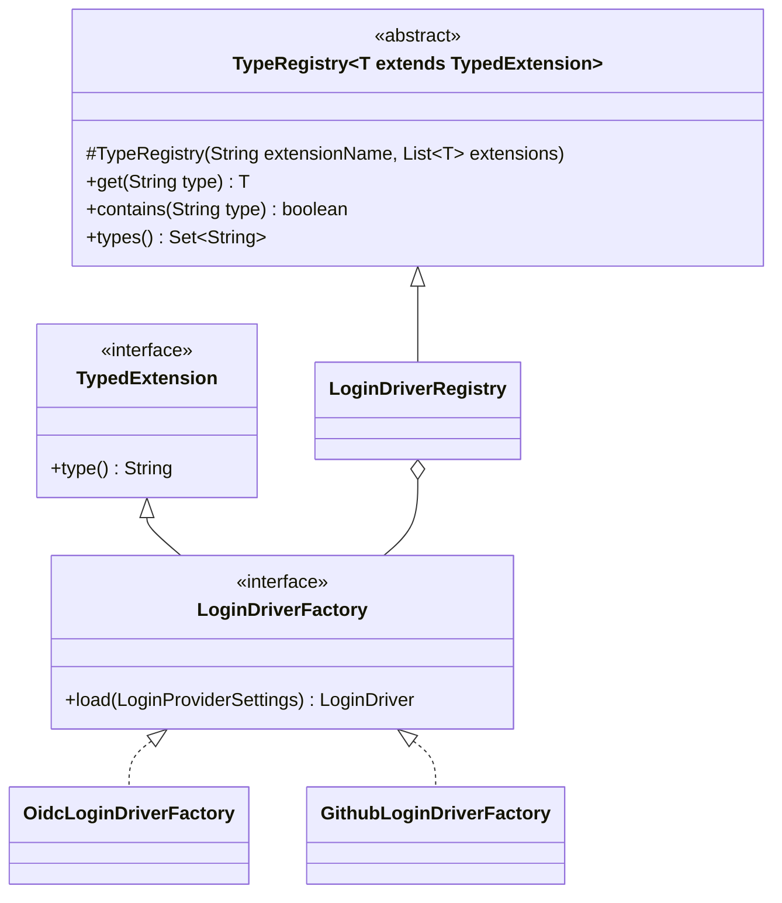
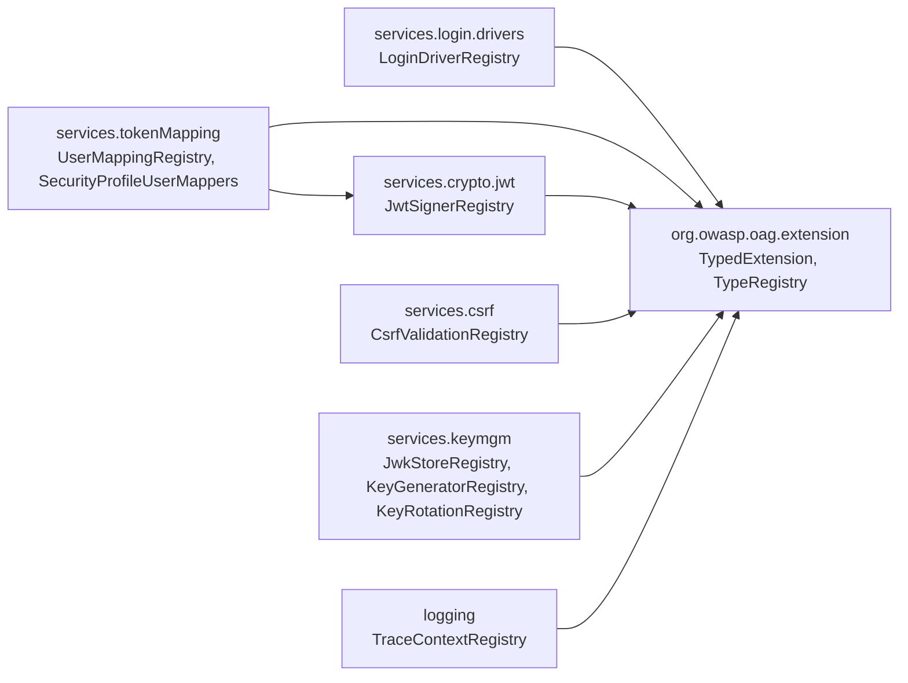

# Unify extension lookup into type registries

**Status:** in progress

**Goal:** Replace the six inconsistent "factory" lookups in `org.owasp.oag.infrastructure.factories` with one
pattern: every extension declares the configuration `type` it handles, and a `TypeRegistry` per extension
point maps that `type` to the implementation. Remove the name clashes between the two kinds of `*Factory`
interfaces and the lookups by Spring bean name.

**Branch:** `feature/00007-extension-registries` (never commit to `main`).

## Current state (problem)

| Extension point | Config value | Today resolved by | Dispatcher today |
|---|---|---|---|
| `LoginDriver` | `loginProviders.*.type` | bean `<type>LoginDriverFactory` | `infrastructure.factories.LoginDriverFactory` + `DefaultLoginDriverFactory` |
| `UserMapper` | `securityProfiles.*.userMapping.type` | bean `<type>UserMappingFactory` | `infrastructure.factories.UserMappingFactory` + `DefaultUserMappingFactory` (also caches one mapper per security profile) |
| `JwtSigner` | `userMapping.settings.signatureImplementation` | bean `<value>JwtSignerFactory` | inline in `JwtTokenUserMappingFactory` |
| `CsrfProtectionValidation` | `securityProfiles.*.csrfProtection` | bean `csrf<Value>Validation` | `CsrfValidationImplementationFactory` + `Default…` |
| `JwkStore`, `KeyGenerator` | `keyManagementProfile.*Profile.type` | bean named exactly `<type>` | `KeyManagementFactory` + `Default…` |
| `TraceContext` (prototype bean) | `traceProfile.type` | bean named exactly `<type>` | `TraceContextFactory` + `Default…` |

Problems: two interfaces with the same simple name (`LoginDriverFactory`, `UserMappingFactory`). Interfaces
with a single implementation that exist only to host a static `get(context)`. Three different naming
conventions. Typos are only detected at runtime. `SecurityProfile.getErrors` catches
`NoSuchBeanDefinitionException`, but the CSRF factory throws `ConfigurationException`, so an unknown
`csrfProtection` crashes validation instead of being reported.

## Decisions

1. **An implementation declares its own type.** Every extension implements `TypedExtension.type()`.
2. **Factory only when needed.** A per-type factory exists only when creating the extension needs
   configuration settings or a fresh instance: `LoginDriverFactory`, `UserMappingFactory`, `JwtSignerFactory`,
   `TraceContextFactory`. Stateless singletons (`CsrfProtectionValidation`, `JwkStore`, `KeyGenerator`)
   register themselves.
3. **Hard break for custom extensions.** Bean names no longer matter, and there is no fallback lookup.
   **Configuration values stay unchanged**, so existing config files keep working.
4. **No package cycles.** `TypedExtension` and `TypeRegistry` live in the neutral package
   `org.owasp.oag.extension`, which depends only on `org.owasp.oag.exception`. Each concrete registry lives
   next to its extension interface (for example `services.login.drivers.LoginDriverRegistry`).
   `org.owasp.oag.infrastructure.factories` is deleted.
5. **One plan, one step per family.** Each step leaves the build green.
6. **Key rotation is included.** `KeyRotation` (new interface implemented by `DefaultKeyRotation`) becomes a
   `TypedExtension` with a `KeyRotationRegistry`. After this iteration no extension is selected by bean name.
7. **All YAML configuration files stay valid.** Every `*.yaml` in the repository (`oag/sample-config.yaml`,
   `oag/src/main/resources/*.yaml`, `oag/src/test/resources/*.yaml`) and every YAML example in the docs is
   checked against the registered types and updated where a value is not a registered type.

## Target design

- `TypeRegistry` builds a `Map<String, T>` from all beans of `T`, which Spring injects as a `List<T>`.
  - A duplicate `type` fails at startup with a `ConfigurationException` that names both classes.
  - `get` on an unknown type throws `ConfigurationException("No <extensionName> for type 'x'. Known types: [..]")`.
- Concrete registries are thin `@Component` subclasses, for example
  `LoginDriverRegistry extends TypeRegistry<LoginDriverFactory>`. They add a convenience method where
  callers need one, such as `LoginDriver load(String type, LoginProviderSettings settings)`.
- Spring cannot resolve `T` through the abstract constructor. Each concrete registry declares its own
  constructor taking `List<ConcreteType>` and passes it to `super`.
- Configuration validation (`ErrorValidation.getErrors(context)`) uses `context.getBean(XxxRegistry.class).contains(type)`
  and reports unknown types as errors that list the known types. Unit tests call `getErrors(null)`, so every
  registry lookup in validation is guarded by `context != null`.
- **Validation order:** config validation runs on `ContextRefreshedEvent` (`StartupEventListeners`), after all
  singletons are built. Beans that resolve an extension while they are constructed throw before validation runs:
  `SecurityProfileUserMappers`, `DefaultKeyRotation`, `JwksController` and `TraceContextBridge`. The
  `TypeRegistry.get` message is therefore the user-facing error for an unknown type at startup. It must name
  the extension point, the bad value and the known types, and callers pass it through unchanged (no re-wrapping).
  Tests for "unknown type is reported" call `getErrors(context)` directly, as `LoginProvidorValidationTest`
  does, instead of booting a context with a bad config.

### Families after the change

| Extension point | Registered element (`type()`) | Registry | Type values (unchanged) |
|---|---|---|---|
| Login | `LoginDriverFactory` (non-generic) | `LoginDriverRegistry` | `oidc`, `github` |
| User mapping | `UserMappingFactory` | `UserMappingRegistry` | `jwtToken`, `no`, `requestHeader` |
| JWT signer | `JwtSignerFactory` | `JwtSignerRegistry` | `rsa`, `hmac` |
| CSRF | `CsrfProtectionValidation` | `CsrfValidationRegistry` | `none`, `sameSiteStrictCookie`, `doubleSubmitCookie`, `doubleSubmitCookieWithBody` |
| JWK store | `JwkStore` | `JwkStoreRegistry` | `localRsaJwkStore` |
| Key generator | `KeyGenerator` | `KeyGeneratorRegistry` | `rsaKeyGenerator` |
| Trace | `TraceContextFactory` (new, per type) | `TraceContextRegistry` | `w3cTraceContext`, `simpleTraceContext`, `noTraceContext` |
| Key rotation | `KeyRotation` | `KeyRotationRegistry` | `defaultKeyRotation` |

Notes per family:
- **User mapping:** the per-security-profile cache in `DefaultUserMappingFactory` is a separate concern. It
  becomes `SecurityProfileUserMappers` in `services.tokenMapping`, which builds one `UserMapper` per used
  security profile at startup through `UserMappingRegistry`. `USER_MAPPER_TYPE_POSTFIX` is removed.
- **JWT signer:** `JwtTokenUserMappingFactory` injects `JwtSignerRegistry` instead of `ApplicationContext`.
  `JWT_SIGNER_FACTORY_BEAN_POSTFIX` is removed.
- **Key management:** `KeyManagementFactory` is removed. `JwksController` and `DefaultKeyRotation` resolve
  through the registries using the type from `MainConfig`. `KeyManagementProfile` validation reports unknown
  types at startup.
- **Trace:** `TraceContext` implementations lose `@Component`/`@Scope(prototype)` and get `MainConfig` through
  their constructor. New factories `W3cTraceContextFactory`, `SimpleTraceContextFactory` and
  `NoTraceContextFactory` create a fresh context per request. `TraceContextBridge` keeps a
  `Supplier<TraceContext>` resolved once from the registry, so its unit tests can keep passing lambdas.
- **Javadoc** is build-enforced (`requireJavadoc`). Every new class, method and field needs it.

## Package layout

Callers (`controllers`, `filters`, `config.configuration`) depend on the registries, and the registries never
depend on them.

## Review findings incorporated

The review of this plan against the code found missed callers and tests (`PostConfigBeanConfiguration`,
`TraceProfile`, `JwkStoreProfile`/`KeyGeneratorProfile`, `RSAKeySignerTest`, `StubJwtSignerFactory`,
`TraceContextBridgeTest`, `SimpleTraceContextTest`). It also found a duplicate-type risk caused by CSRF
subclassing, the validation-order constraint described above, and wrong configuration values in several docs.
The steps below include all of them.

## Steps

Each step: TDD (write the failing test first), then implement, then run `./gradlew build` from `oag/` (green),
then commit.

### 0. Preparation
- [x] Create branch `feature/00007-extension-registries` from `main`.
- [x] Record baseline: `./gradlew build` test count — 142 tests, 0 failures.

### 1. Base types
- [x] `TypeRegistryTest` (unit): lookup by type, unknown type message lists known types, duplicate type fails, `contains`, `types`.
- [x] Implement `TypedExtension` and `TypeRegistry` in `org.owasp.oag.extension`.

### 2. Login drivers
- [x] Unit: `OidcLoginDriverFactory.type()` = `oidc`, `GithubLoginDriverFactory.type()` = `github`; `LoginDriverRegistryTest`.
- [x] Make `services.login.drivers.LoginDriverFactory` non-generic and extend `TypedExtension`; add `type()` to both factories.
- [x] Add `LoginDriverRegistry`; switch `LoginController` and `LoginProvider.getErrors` to it.
- [x] Delete `infrastructure.factories.LoginDriverFactory` and `DefaultLoginDriverFactory`.
- [x] Integration: extend the existing `LoginProvidorValidationTest.testInvalidProviderName` to assert that the error lists the known types.

### 3. User mapping
- [x] Unit: `type()` of the three factories; `SecurityProfileUserMappersTest` (mapper per profile, unknown profile error).
- [x] `UserMappingFactory extends TypedExtension`; remove `USER_MAPPER_TYPE_POSTFIX`.
- [x] Add `UserMappingRegistry` and `SecurityProfileUserMappers` (passes `ConfigurationException`s from factories through unchanged); switch `UserMappingFilter` and `UserMappingConfig.getErrors`.
- [x] Delete `infrastructure.factories.UserMappingFactory` and `DefaultUserMappingFactory`.
- [x] Integration: existing `HeaderMappingTest` and JWT mapping tests stay green; unknown `userMapping.type` is reported by validation.

### 4. JWT signer
- [x] Unit: `type()` of `RsaJwtSignerFactory` (`rsa`) and `HmacJwtSignerFactory` (`hmac`).
- [x] `JwtSignerFactory extends TypedExtension`; remove `JWT_SIGNER_FACTORY_BEAN_POSTFIX`; add `JwtSignerRegistry`.
- [x] `JwtTokenUserMappingFactory` uses `JwtSignerRegistry`; unknown `signatureImplementation` gives a `ConfigurationException` listing known types.
- [x] Tests: add `type()` to `StubJwtSignerFactory`; switch `RSAKeySignerTest` from bean name + postfix to `JwtSignerRegistry`.

### 5. CSRF
- [x] Unit: `type()` of the four validations; `CsrfValidationRegistryTest`. `CsrfDoubleSubmitCookieWithBodyValidation` extends `CsrfDoubleSubmitCookieValidation` and must override `type()` (`doubleSubmitCookieWithBody`). A test guards against the duplicate-type startup failure.
- [x] Replace the hard-coded `"sameSiteStrictCookie"` in `LoginController` with the type constant of `CsrfSameSiteStrictCookieValidation`.
- [x] `CsrfProtectionValidation extends TypedExtension`; add `CsrfValidationRegistry`.
- [x] Switch `CsrfValidationFilter`, `CsrfValidationFilterWithBody`, `LoginController` and `SecurityProfile.getErrors` (use `contains`, which fixes the wrong-exception bug).
- [x] Delete `CsrfValidationImplementationFactory` and `DefaultCsrfValidationImplementationFactory`.
- [x] Integration: unknown `csrfProtection` is reported as a validation error (not an exception); existing CSRF tests stay green.

### 6. Key management
- [ ] Unit: `type()` of `LocalRsaJwkStore` and `RsaKeyGenerator`; registry tests.
- [ ] `JwkStore` and `KeyGenerator` extend `TypedExtension`; add `JwkStoreRegistry` and `KeyGeneratorRegistry`.
- [ ] Switch `JwksController` and `DefaultKeyRotation`. Switch the existing `containsBean` checks in `JwkStoreProfile.getErrors` and `KeyGeneratorProfile.getErrors` to the registries (null-context guard).
- [ ] Delete `KeyManagementFactory` and `DefaultKeyManagementFactory`.
- [ ] Key rotation: introduce `KeyRotation extends TypedExtension` (implemented by `DefaultKeyRotation`, type `defaultKeyRotation`) and `KeyRotationRegistry`; switch `KeyRotationProfile.getErrors` from `containsBean` to the registry and fix its messages.
- [ ] Integration: JWKS endpoint and key rotation tests stay green.

### 7. Trace
- [ ] Unit: each new `*TraceContextFactory` returns a new instance per call with the right `type()`. Adapt `TraceContextBridgeTest` (it uses `new W3cTraceContext()` plus `ReflectionTestUtils.setField(…"config"…)`) and `SimpleTraceContextTest` (no-arg constructor) to constructor injection.
- [ ] Add per-type `TraceContextFactory` (in `org.owasp.oag.logging`) and the three factories; remove `@Component`/`@Scope` from contexts.
- [ ] Delete the `traceContext` bean in `PostConfigBeanConfiguration` (it looks up a context by bean name). Delete the class if it is then empty.
- [ ] Switch `TraceProfile.getErrors` from `containsBean` to `TraceContextRegistry.contains` and correct its messages (`w3cTraceContext`/`noTraceContext`, not `w3cTrace`/`noTrace`).
- [ ] Add `TraceContextRegistry`; `TraceContextBridge` uses a `Supplier<TraceContext>`.
- [ ] Delete `infrastructure.factories.TraceContextFactory` and `DefaultTraceContextFactory`, and the now-empty package `infrastructure.factories`.
- [ ] Integration: `W3CTracingTest`, `SimpleTracingTest` and `TracingTest` stay green; unknown `traceProfile.type` is reported at startup.

### 8. Configuration files
- [ ] Verify every `type`, `csrfProtection` and `signatureImplementation` value in all repository YAML files (`oag/sample-config.yaml`, `oag/src/main/resources/*.yaml`, `oag/src/test/resources/*.yaml`) is a registered type; update any that is not.
- [ ] Unit/integration: a test loads `default-config.yaml` and `sample-config.yaml` and asserts `getErrors(context)` is empty.

### 9. Documentation
- [ ] `www/docs/docs/Custom-(code)-extensions.md`: rewrite "How an extension is selected" (implement `type()`; registry; factory only when settings or a fresh instance are needed; mermaid diagram). Update the "Selected by" line for each extension point.
- [ ] `www/docs/docs/JWT-Signer-(add-custom-new-signature-type-to-JWT).md`: `type()` instead of the bean-name postfix.
- [ ] `www/docs/docs/Tracing-Log-Correlation.md` ("Define class and bean name"): custom trace via a `TraceContextFactory`.
- [ ] `Tracing-Log-Correlation-Correlation-Logging.md:61-62`: correct values (`w3cTraceContext`, `simpleTraceContext`, `noTraceContext`); replace "Beanname of custom trace" with "`type()` of a custom `TraceContextFactory`".
- [ ] `Csrf-Protection.md:5-13`: rewrite the `Csrf<Name>Validation` naming rule as `type()`.
- [ ] Fix wrong CSRF values: `Configuration-SecurityProfiles.md:11,138` (`samesite-strict-cookie`), `Glossary.md:43,100` (`double-submit-cookie`/`samesite-strict-cookie`), and the `csrfProtection: samesite` example. Use the real values.
- [ ] Check `Configuration-User-Mapping.md`, `Configuration-Login-Providers.md` and `Key-management-and-JWT-signer.md` for bean-name wording.
- [ ] Glossary (`www/docs/docs/Glossary.md` and `implementation-progress/00002-glossary.md`): add *Extension type*, *Type registry*, *Extension factory*; adjust `type`. Rewrite "Bean name" (`Glossary.md:35`, `00002-glossary.md:88`) and "Custom (code) extension" (`Glossary.md:45`): selection is by `type()`, including key rotation; update `Automatic-Key-Rotation.md` accordingly.
- [ ] Every YAML example in `www/docs/docs/*.md` uses registered type values.

### 10. Review & finish
- [ ] Review against the CLAUDE.md checklist (cycles, naming, packages, class size, tests, docs, glossary). Verify no `containsBean`/`getBean(<String>` lookups of extensions remain.
- [ ] `./gradlew build` green; test count ≥ baseline.
- [ ] Mark the plan as finished.
