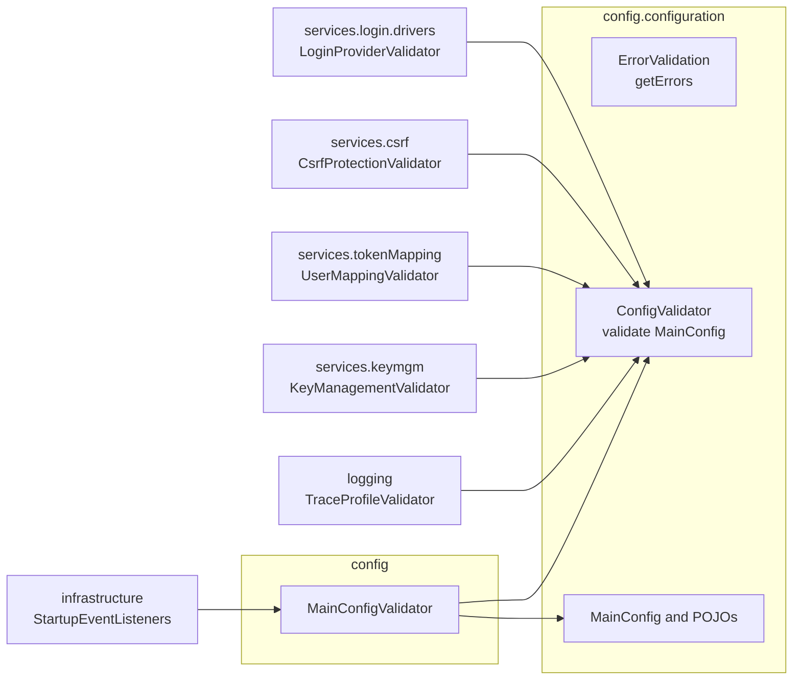

# TODO

## Resolve package cycles

Analysis of `oag/src/main` after iteration `00007` (branch `feature/00007-extension-registries`), based on a
package-level import graph.

**Result:** 11 two-package cycles. Together they make 15 packages mutually reachable: root, `config`,
`config.configuration`, `cookies`, `filters`, `filters.servlet`, `hooks.session`, `infrastructure`, `logging`,
`services.blacklist`, `services.csrf`, `services.keymgm`, `services.login.drivers`, `services.tokenMapping`,
`session`. A separate 2-package cycle exists between `filters.proxy` and `gateway`.

### Findings

| # | Cycle | One direction | Back edge (the problem) |
|---|---|---|---|
| 1–5 | `config.configuration` ↔ `services.login.drivers`, `services.csrf`, `services.keymgm`, `services.tokenMapping`, `logging` | Extensions import `MainConfig` or settings classes (the natural direction) | Config POJOs validate their types in `getErrors(context)`: `LoginProvider → LoginDriverRegistry`, `SecurityProfile → CsrfValidationRegistry`, `JwkStoreProfile`/`KeyGeneratorProfile`/`KeyRotationProfile → *Registry`, `UserMappingConfig → UserMappingRegistry`, `TraceProfile → TraceContextRegistry` |
| 6 | `config` ↔ `config.configuration` | `ConfigLoader`/`FileConfigLoader → MainConfig` | 12 config classes implement `config.ErrorValidation` |
| 7 | root ↔ `infrastructure` | `EnableOWASPApplicationGateway → OAGBeanConfiguration` | `StartupEventListeners` uses `OWASPApplicationGatewayApplication.class` only as its logger name |
| 8 | `infrastructure` ↔ `services.blacklist` | `OAGBeanConfiguration` creates the blacklist bean | `LocalPersistentBlacklist → GlobalClockSource` |
| 9 | `cookies` ↔ `session` | `LoginCookie → UserModel` | `Session` holds a `LoginCookie` and builds itself from one (`fromSessionCookie`); the only outside caller of `getLoginCookie()` is `CsrfCookieCreationHook`, which only reads the CSRF token |
| 10 | `filters.servlet` ↔ `hooks.session` | `SessionRenewalFilter → SessionHookChain` | `AddSessionToBlacklistHook` imports `ExtractAuthenticationFilter` but never uses it |
| 11 | `filters.proxy` ↔ `gateway` | `RouteAwareFilter` reads `GatewayRouterFunctionConfiguration.ATTRIBUTE_ROUTE_NAME` | The gateway configuration collects all `RouteAwareFilter`s |

Additional edge: `CsrfSameSiteStrictCookieValidation` calls `ExtractAuthenticationFilter.findCookie`, so a
service depends on a servlet filter. Moving it to `cookies.CookieReader` was planned as Task 7 of iteration
`00006` but was not implemented.

Compared with `main`, iteration `00007` removed three cycles (all through `infrastructure.factories`) and added
cycles 3–5. Cycles 1 and 2 follow the same pattern and already existed on `main`.

### Suggestions

- **A. Configuration validation (cycles 1–5).** Done (iteration `00009`, separate validators), see
  [A in detail](#a-in-detail-configuration-validation-without-back-edges).
- **D. `infrastructure` ↔ `services.blacklist`.** Move `GlobalClockSource` (a leaf utility used by
  `filters.servlet`, `hooks.session`, `services.blacklist`, `services.tokenMapping.jwt`) to a dependency-free
  package such as `org.owasp.oag.clock` or `utils`. Alternative: move the `sessionBlacklist` bean into a
  configuration class in `services.blacklist`.
- **E. `cookies` ↔ `session`.** A session should not know its cookie representation:
  - `Session` keeps the CSRF token instead of the whole `LoginCookie`.
  - `CsrfCookieCreationHook` reads the token from the session.
  - `fromSessionCookie` moves to the cookie side (e.g. `LoginCookie.toSession(clock)`).
- **F. `filters.servlet` ↔ `hooks.session`.** Delete the unused import in `AddSessionToBlacklistHook`.
  Implement `00006` Task 7: move `findCookie` to `cookies.CookieReader`, which unhooks `services.csrf` from the
  filters.

### Suggested order

| Step | Content | Effort | Risk |
|---|---|---|---|
| 1 | C, F (unused import), G, B | minutes each | none |
| 2 | D, F (`CookieReader`) | small | low |
| 3 | E (session/cookie split) | medium | touches session handling, needs careful tests |
| 4 | ~~A (config validators)~~ done | medium to large | — |
| 5 | ~~H (ArchUnit test)~~ done, with a list of known exceptions | small | — |

Steps 1 and 2 alone remove 5 of the 11 cycles without behaviour change.

### Open questions

- [x] A: separate `ConfigValidator`s per extension point (decided and implemented in `00009`).
- [ ] One new iteration plan (`00008`) or an extra step on the `00007` branch before merging?

## A in detail: configuration validation without back edges

### Problem

Config POJOs in `config.configuration` validate in two ways in one method, `getErrors(ApplicationContext)`:
- **structure** (field missing, value out of range), which needs nothing but the POJO, and
- **extension types** (is `type` a registered type, can the login driver be built), which needs a registry
  bean from a `services.*` or `logging` package.

The second kind creates the five back edges `config.configuration → services.login.drivers`, `services.csrf`,
`services.keymgm`, `services.tokenMapping` and `logging`. It also explains the `context == null` guards and the
`getErrors(null)` calls in unit tests.

| POJO | Registry lookup today |
|---|---|
| `LoginProvider` | `LoginDriverRegistry`: type known, then `load(type, with)` to collect setting errors |
| `SecurityProfile` | `CsrfValidationRegistry`: `csrfProtection` known |
| `UserMappingConfig` | `UserMappingRegistry`: type known |
| `JwkStoreProfile`, `KeyGeneratorProfile`, `KeyRotationProfile` | `JwkStoreRegistry`, `KeyGeneratorRegistry`, `KeyRotationRegistry`: type known |
| `TraceProfile` | `TraceContextRegistry`: type known |

### Target design

Split the two kinds. POJOs keep the structure checks. Each extension point contributes a `ConfigValidator`
bean next to its registry, which checks the types of its part of `MainConfig`. A small aggregator runs both.



All arrows point to `config.configuration` or `config`; the five back edges disappear.

**1. `ErrorValidation.getErrors()` without parameter** (`config.configuration`)
- Remove the `ApplicationContext` parameter from the interface and all 12 implementations, and drop the
  `context == null` guards.
- Structure checks stay as they are (for example `LoginProvider`: `type` and `with` present;
  `SecurityProfile`: `csrfProtection` present).
- Fix on the way: `UserMappingConfig` reports a missing `type` only when a context exists. Without the guard it
  is always reported. `KeyRotationProfile` ends with a redundant `if (!errors.isEmpty()) return errors;`.
- The `log.info("Using ... implementation of {}")` lines move to the validators.

**2. `ConfigValidator` interface** (`config.configuration`, next to `ErrorValidation`)
```java
/** Validates the part of the configuration that depends on registered extensions. */
public interface ConfigValidator {
    /** @param config a configuration without structural errors  @return error messages, empty if valid */
    List<String> validate(MainConfig config);
}
```
It is placed in `config.configuration` and not in `config`, so that extension packages depend on one config
package only.

**3. One validator per extension point**, a `@Component` next to its registry and injected with it:

| Validator | Package | Checks |
|---|---|---|
| `LoginProviderValidator` | `services.login.drivers` | per `loginProviders` entry: type known, otherwise `load(type, with)` and collect `InvalidProviderSettingsException.getSettingErrors()` and other `RuntimeException` messages |
| `CsrfProtectionValidator` | `services.csrf` | per `securityProfiles` entry: `csrfProtection` known |
| `UserMappingValidator` | `services.tokenMapping` | per `securityProfiles` entry: `userMapping.type` known |
| `KeyManagementValidator` | `services.keymgm` | `jwkStoreProfile`, `keyGeneratorProfile`, `keyRotationProfile` types known (one validator, three registries) |
| `TraceProfileValidator` | `logging` | `traceProfile.type` known, keeps the hint "Specify 'noTraceContext' …" |

- Error messages name the config entry, which today's messages do not, for example
  `LoginProvider 'github': Unknown type 'githb'. Known types: [github, oidc]`.
- To avoid five copies of the same message, `TypeRegistry` gets one helper (it stays in the neutral
  `extension` package):
  ```java
  /** @return an error for an unknown type, empty if the type is registered */
  public Optional<String> unknownTypeError(String configEntry, String type)
  ```

**4. `MainConfigValidator`** (`config`, `@Component`)
```java
public List<String> validate(MainConfig config) {
    var errors = config.getErrors();
    if (!errors.isEmpty()) return errors;            // validators may rely on a complete structure
    return validators.stream().flatMap(v -> v.validate(config).stream()).toList();
}
```
- Running validators only on a structurally valid config means they need no null checks. The cost: a user with
  both kinds of errors sees them in two rounds. This is acceptable because structure errors are rare after
  merging with `default-config.yaml`.
- `StartupEventListeners.validateConfigurationAfterContextInitialized` calls
  `mainConfigValidator.validate(config)` instead of `config.getErrors(context)`, and no longer needs
  `ApplicationContext`.

### Registry or separate validator? (open question 1)

Recommendation: **separate validators.**
- A registry is a lookup by type and stays generic. A validator knows where its type lives in the
  configuration tree (`securityProfiles.*.csrfProtection`).
- Key management has three registries but one configuration section, so one validator is simpler than three
  registries that each walk `MainConfig`.
- The login validator builds drivers to check settings, which is more than a registry should do.
- The cost is five small classes of about 20 lines each.

### Tests

- **Unit tests per validator** (`test`): build the registry with stub extensions, for example
  `new CsrfValidationRegistry(List.of(stubWithType("none")))`, and a `MainConfig` with the matching section.
  Cover: known type gives no error, unknown type gives an error with entry name, value and known types.
  `LoginProviderValidatorTest` also covers invalid settings with the real `OidcLoginDriverFactory`.
- **Unit tests for `MainConfigValidator`**: structure errors stop the validators; otherwise the errors of all
  validators are concatenated.
- **POJO unit tests**: `getErrors(null)` becomes `getErrors()`. Add a test for the missing `type` in
  `UserMappingConfig`.
- **Integration tests**:
  - `ExtensionTypeValidationTest` uses `MainConfigValidator` for `sample-config.yaml` and the test YAML
    files. Its unknown-type tests move to the validator unit tests.
  - `LoginProvidorValidationTest` (typo in the name) moves into `LoginProviderValidatorTest`.
  - A new startup test: a context with an unknown `csrfProtection` fails with a `ConfigurationException` that
    names the entry.
    - Use `csrfProtection`, because no bean resolves it while it is constructed.
    - `SecurityProfileUserMappers`, `DefaultKeyRotation`, `JwksController` and `TraceContextBridge` resolve
      their type in the constructor and fail before the validators run. This is unchanged by A and is a
      separate item.
- **`PackageCycleTest`**: remove the five `config.configuration` entries from `KNOWN_BACK_EDGES`.
  `knownBackEdgesStillExist` makes sure this happens.

### Steps (each leaves the build green)

1. Add `ConfigValidator`, `MainConfigValidator` (with an empty validator list) and
   `TypeRegistry.unknownTypeError`, with tests. Switch `StartupEventListeners`.
2. One extension point per step: add the validator and its tests, remove the registry lookup from the POJO.
   Order: trace, key management, CSRF, user mapping, login (login is the largest).
3. Remove the `ApplicationContext` parameter from `ErrorValidation` and adapt the tests.
4. Shrink `KNOWN_BACK_EDGES`; `./gradlew build`.
5. Docs: in `Custom-(code)-extensions.md`, describe how the configured type is validated at startup (a new
   *extension point* adds a `ConfigValidator`; a new *type* for an existing point only needs `type()`).
   Glossary: no new user-facing term.

Effort: about 5 new classes plus tests, 12 changed POJOs. No configuration file or user-visible behaviour
changes, apart from more precise error messages.

## Test infrastructure: test configurations leak into every test context

`OAGBeanConfiguration` has its own `@ComponentScan` of `controllers`, `filters`, `services`, … without the
`TypeExcludeFilter` that `@SpringBootApplication` uses. It therefore registers nested test configurations
(for example `RSAKeySignerTest.PathTestConfig`, `DefaultKeyRotationTest`'s `@TestConfiguration`) in every
`@SpringBootTest` context. This is why all integration tests need
`spring.main.allow-bean-definition-overriding=true`, and why a full application start from a test cannot be
isolated. Fix: add `excludeFilters = @ComponentScan.Filter(type = FilterType.CUSTOM, classes = TypeExcludeFilter.class)`
and check which tests relied on foreign configurations.

## Other open items from iteration 00007

- [ ] Run `npm run docs:build` in `www/` once (npm was not available when the docs were changed).
- [ ] Merge `feature/00007-extension-registries` (not merged; never commit to `main` directly).
