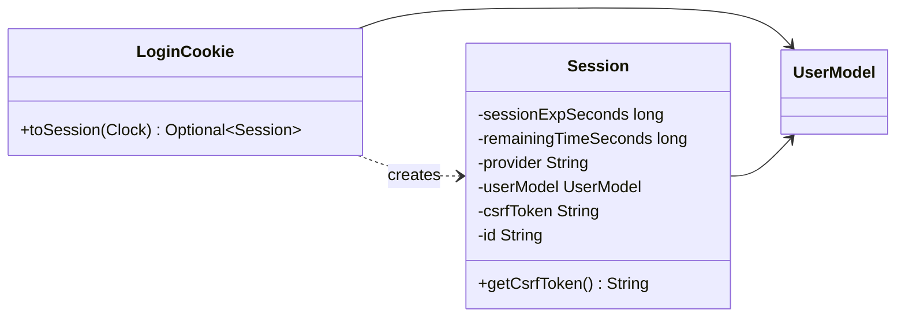

# TODO

## Resolve package cycles

Analysis of `oag/src/main` after iteration `00007` (branch `feature/00007-extension-registries`), based on a
package-level import graph.

**Result:** 11 two-package cycles. Together they make 15 packages mutually reachable: root, `config`,
`config.configuration`, `cookies`, `filters`, `filters.servlet`, `hooks.session`, `infrastructure`, `logging`,
`services.blacklist`, `services.csrf`, `services.keymgm`, `services.login.drivers`, `services.tokenMapping`,
`session`. A separate 2-package cycle exists between `filters.proxy` and `gateway`.

### Findings

| # | Cycle | One direction | Back edge (the problem) |
|---|---|---|---|
| 1–5 | `config.configuration` ↔ `services.login.drivers`, `services.csrf`, `services.keymgm`, `services.tokenMapping`, `logging` | Extensions import `MainConfig` or settings classes (the natural direction) | Config POJOs validate their types in `getErrors(context)`: `LoginProvider → LoginDriverRegistry`, `SecurityProfile → CsrfValidationRegistry`, `JwkStoreProfile`/`KeyGeneratorProfile`/`KeyRotationProfile → *Registry`, `UserMappingConfig → UserMappingRegistry`, `TraceProfile → TraceContextRegistry` |
| 6 | `config` ↔ `config.configuration` | `ConfigLoader`/`FileConfigLoader → MainConfig` | 12 config classes implement `config.ErrorValidation` |
| 7 | root ↔ `infrastructure` | `EnableOWASPApplicationGateway → OAGBeanConfiguration` | `StartupEventListeners` uses `OWASPApplicationGatewayApplication.class` only as its logger name |
| 8 | `infrastructure` ↔ `services.blacklist` | `OAGBeanConfiguration` creates the blacklist bean | `LocalPersistentBlacklist → GlobalClockSource` |
| 9 | `cookies` ↔ `session` | `LoginCookie → UserModel` | `Session` holds a `LoginCookie` and builds itself from one (`fromSessionCookie`); the only outside caller of `getLoginCookie()` is `CsrfCookieCreationHook`, which only reads the CSRF token |
| 10 | `filters.servlet` ↔ `hooks.session` | `SessionRenewalFilter → SessionHookChain` | `AddSessionToBlacklistHook` imports `ExtractAuthenticationFilter` but never uses it |
| 11 | `filters.proxy` ↔ `gateway` | `RouteAwareFilter` reads `GatewayRouterFunctionConfiguration.ATTRIBUTE_ROUTE_NAME` | The gateway configuration collects all `RouteAwareFilter`s |

Additional edge: `CsrfSameSiteStrictCookieValidation` called `ExtractAuthenticationFilter.findCookie`, so a
service depended on a servlet filter. Resolved by F.

Compared with `main`, iteration `00007` removed three cycles (all through `infrastructure.factories`) and added
cycles 3–5. Cycles 1 and 2 follow the same pattern and already existed on `main`.

### Suggestions

- **E. `cookies` ↔ `session`.** Done (iteration `00011`): `Session` holds the CSRF token instead of the
  `LoginCookie`, and `LoginCookie.toSession(Clock)` replaces `Session.fromSessionCookie`. No package cycle is
  left; `PackageCycleTest` runs the plain rule without exceptions. Details:
  [E in detail](#e-in-detail-separate-session-and-login-cookie).
- **F. `findCookie` in a servlet filter.** Done (iteration `00013`): `cookies.CookieReader.findCookie` replaces
  `ExtractAuthenticationFilter.findCookie`; `LayeringTest` forbids dependencies on `filters.servlet` from outside.
- **G. Handler-mapping order.** Open (other half of `00006` Task 7): move the `static` `BeanPostProcessor`
  `routerFunctionMappingAfterControllers` out of `GatewayRouterFunctionConfiguration` into its own
  configuration class, so that class only assembles routes. Keep its explanatory comment.

### Suggested order

| Step | Content | Effort | Risk |
|---|---|---|---|
| 2 | ~~F (`CookieReader`)~~ done | small | — |
| 3 | ~~E (session/cookie split)~~ done | small | — |

Steps 1 and 2 alone remove 5 of the 11 cycles without behaviour change.

## E in detail: separate session and login cookie

### Problem

`org.owasp.oag.session.Session` depends on `org.owasp.oag.cookies.LoginCookie` in two places:
- it **holds the whole cookie** (field `loginCookie`, getter `getLoginCookie()`, constructor parameter), and
- it **builds itself from the cookie** (`Session.fromSessionCookie(LoginCookie, Clock)`).

`LoginCookie` depends on `session.UserModel` (the natural direction: the cookie stores the session data), which
closes the cycle. This is the last entry in `PackageCycleTest.KNOWN_BACK_EDGES`.

Who uses the back edge:

| Use | Where | What it really needs |
|---|---|---|
| `Session.fromSessionCookie(cookie, clock)` | `ExtractAuthenticationFilter` | expiry, provider, user model, id from the cookie |
| `session.getLoginCookie().getCsrfToken()` | `CsrfCookieCreationHook.renewSession` | only the CSRF token |
| `new Session(..., null, ...)` | 4 unit tests | nothing (they pass `null`) |

### Target design

The session holds the values it represents, and the cookie knows how to turn itself into a session.

1. **`Session` keeps the CSRF token, not the cookie.** It replaces the field `LoginCookie loginCookie` with
   `String csrfToken`, `getLoginCookie()` with `getCsrfToken()`, and the constructor parameter `LoginCookie
   loginCookie` with `String csrfToken`, in the same position. The tests that pass `null` compile unchanged.
2. **`fromSessionCookie` moves to the cookie** as `LoginCookie.toSession(Clock clock)`, returning
   `Optional<Session>`, empty when expired. The logic is unchanged. The `null` check becomes the caller's job;
   `ExtractAuthenticationFilter` only calls it on a present cookie.
   - `LoginCookie` is serialized with Jackson. `toSession` is not a bean getter, so the cookie format does
     not change. A test checks this.
   - Alternative: put the conversion in `CookieConverter`, next to the other cookie conversions. It is a
     Spring bean and needs the clock as well, so `LoginCookie.toSession` is the simpler choice.
3. **`CsrfCookieCreationHook.renewSession`** reads `session.getCsrfToken()`.
4. **`ExtractAuthenticationFilter`** calls `loginCookie.toSession(clock)`. Everything else stays as it is.

Afterwards `session` imports nothing from OAG apart from its own package. `cookies → session` stays and is
the intended direction.

### Compatibility

`Session` is part of the extension API: extensions read it from `Session.REQUEST_SESSION`. Removing
`getLoginCookie()` and `fromSessionCookie` and changing the constructor is a breaking change for custom
extensions that use them. None of the built-in extensions do, and the documentation never mentions them.

### Tests

- **Unit `LoginCookieTest`:**
  - `toSession` on a valid cookie copies expiry, remaining time, provider, user model, id and CSRF token.
  - An expired cookie gives an empty result.
  - The JSON form of a `LoginCookie` has no `session` property, so the cookie format is unchanged.
- **Unit `ExtractAuthenticationFilterTest`** (exists): additionally assert that the session carries the
  CSRF token of the cookie.
- **Integration `SessionRenewalTest`** (exists): after a renewal, the new session cookie still carries the
  CSRF token of the old one. Add an assertion if the test does not cover it yet.
- **`PackageCycleTest`:** remove the last `KNOWN_BACK_EDGES` entry. The list is then empty, so the exception
  mechanism (and its disabled state) can be removed, leaving the plain rule
  `slices().matching("org.owasp.oag.(**)").should().beFreeOfCycles()`. Whether to keep the mechanism for
  future exceptions **needs a decision**. Recommendation: remove it; a new cycle should be fixed, not listed.

### Steps (each leaves the build green)

1. Add `LoginCookie.toSession` with tests; switch `ExtractAuthenticationFilter`; delete
   `Session.fromSessionCookie`.
2. Replace `loginCookie` by `csrfToken` in `Session`; switch `CsrfCookieCreationHook`; adapt the tests.
3. Clean up `PackageCycleTest` (see above); `./gradlew build` fully green, including the cycle rule.
4. Docs: in `Custom-(code)-extensions.md` ("Reading the state of the current request"), mention
   `Session.getCsrfToken()`. Glossary: no change.

Effort: small. Two main classes change (`Session`, `LoginCookie`), plus two callers and four tests that only
change a constructor argument.
