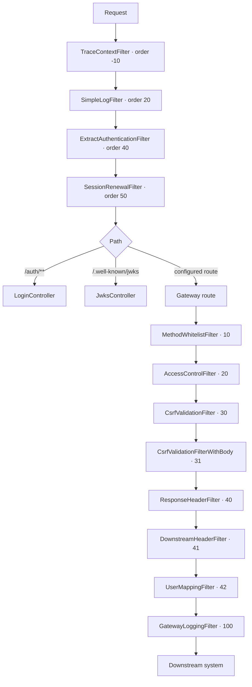

# Request handling

OAG is a Spring Cloud Gateway Server MVC application running on Apache Tomcat. Every request is handled
on its own virtual thread, so all OAG code is plain sequential Java: there is no reactive stream, no event
loop and no thread pool to size.

## Pipeline

The two tiers differ in scope:

- **Servlet filters** (`org.owasp.oag.filters.servlet`) run for every request before routing, including
  OAG's own `/auth` and `/.well-known` endpoints. They handle tracing, request logging, session
  extraction and session renewal.
- **Route filters** (`org.owasp.oag.filters.proxy`) are `HandlerFilterFunction`s attached to each
  configured gateway route. They run in `@Order` sequence for proxied traffic only, and have access to
  the route's security profile and session through `GatewayRouteContext`.

`RequestFailureLogger` sits outside both tiers. It is a `HandlerExceptionResolver` rather than a filter,
because the `DispatcherServlet` turns a `ResponseStatusException` into a status code and never rethrows
it, so the failure reason is not observable from a filter. It only observes and logs; the standard
resolvers still produce the response.

## Trace id and logging

`TraceContextFilter` puts the request's trace id in the MDC for the whole request. Because a request never
changes thread, every log statement written while handling it carries the trace id — including statements in
code that has no access to the request object. Use `%X{oag.CorrId}` in the log pattern to print it.

## What is not supported

WebSocket traffic is not proxied. Configure a separate route on a component that supports it if you need
WebSockets behind OAG.
