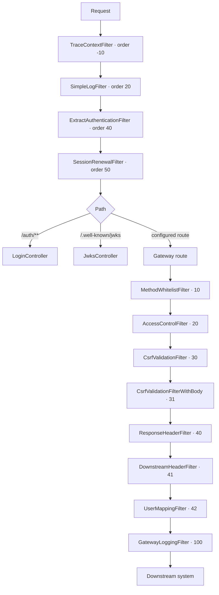

# Request handling

OAG is a Spring Cloud Gateway Server MVC application running on Apache Tomcat. Every request is handled
on its own virtual thread, so all OAG code is plain sequential Java: there is no reactive stream, no event
loop and no thread pool to size.

## Pipeline

The two tiers differ in scope:

- **Servlet filters** (`org.owasp.oag.filters.servlet`) run for every request before routing, including
  OAG's own `/auth` and `/.well-known` endpoints. They handle tracing, request logging, session
  extraction and session renewal.
- **Route filters** (`org.owasp.oag.filters.proxy`) are `HandlerFilterFunction`s attached to each
  configured gateway route. They run in `@Order` sequence for proxied traffic only, and have access to
  the route's security profile and session through `GatewayRouteContext`.

`RequestFailureLogger` sits outside both tiers. It is a `HandlerExceptionResolver` rather than a filter,
because the `DispatcherServlet` turns a `ResponseStatusException` into a status code and never rethrows
it, so the failure reason is not observable from a filter. It only observes and logs; the standard
resolvers still produce the response.

## Request-scoped state

State that belongs to one request is carried in `ScopedValue`s rather than in request attributes. Each of the
two servlet filters that establish such state binds it and then runs the remainder of the filter chain inside
that binding, so everything downstream — later filters, route filters, controllers and extensions — reads it
without being handed the request object:

| Scoped value | Bound by | Holds |
| ------------ | -------- | ----- |
| `TraceContext.REQUEST_TRACE_HEADERS` | `TraceContextFilter` | The `TraceHeaders` of the request: trace id, headers to send downstream, headers to return upstream. |
| `Session.REQUEST_SESSION` | `ExtractAuthenticationFilter` | The `Optional<Session>` of the request; empty when there is no valid session. |
| `CsrfCookie.REQUEST_CSRF_TOKEN` | `ExtractAuthenticationFilter` | The CSRF token taken from the session cookie, or `null` when there is no usable session cookie. |

A scoped value is only readable inside the binding. This is what fixes the position of the two filters in the
pipeline: `TraceContextFilter` runs first and `ExtractAuthenticationFilter` before anything that needs the
session, and neither may hand the chain on outside its `run(...)` block. Reading one of these values outside
a request — from a scheduled task, for instance — throws `NoSuchElementException`, so code that can run in
both places has to check with `isBound()` first.

## Trace id and logging

`TraceContextFilter` binds the request's trace id in a scoped diagnostic context (`ScopedMDC`) around the rest
of the chain. Every log statement written while handling the request therefore carries the trace id, including
statements in code that has no access to the request object. Use `%scopedContext{oag.CorrId}` in the log
pattern to print it — the classic `%X{oag.CorrId}` reads Logback's thread-bound MDC and stays empty. See
[Logging](/docs/Logging) for the log configuration.

## Request bodies

Request bodies are forwarded to the downstream system unbuffered, with one exception.

For a `POST` carrying `Content-Type: application/x-www-form-urlencoded`, the body is parsed to read the
request's parameters and then re-encoded before being forwarded. Parameter order and repeated parameter
names are preserved; the encoding of a space is not — a space sent as `%20` arrives downstream as `+`.
Both forms decode to a space, so a downstream system that parses the form sees exactly the parameters
the caller sent. The distinction only matters to a downstream system that computes a signature or hash
over the raw body bytes rather than over the parsed parameters.

Bodies of every other method and content type, including a `PUT`, `PATCH` or `DELETE` carrying form
content, are passed through byte-for-byte.

## What is not supported

WebSocket traffic is not proxied. Configure a separate route on a component that supports it if you need
WebSockets behind OAG.
